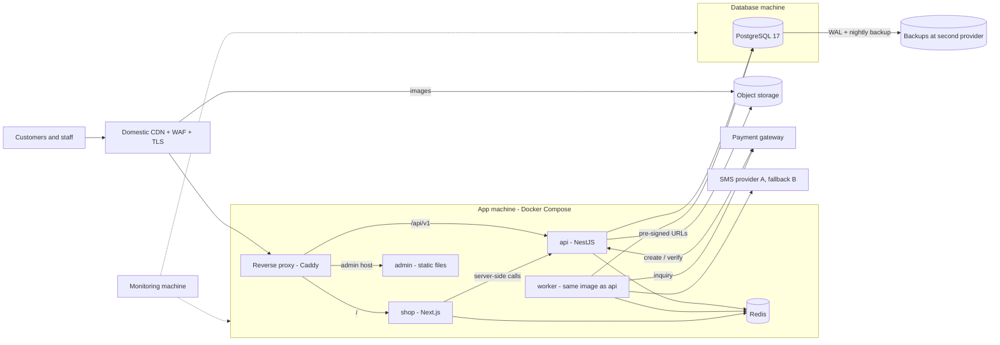
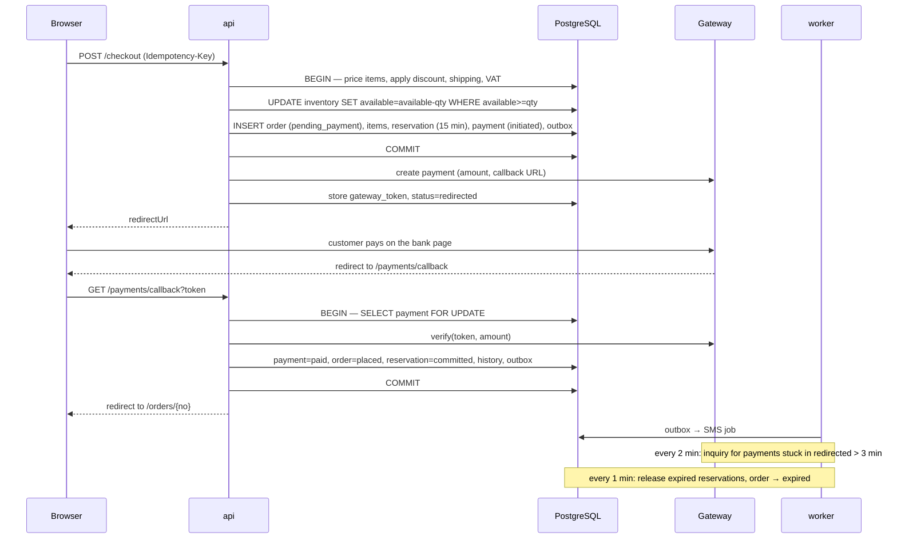

# Emdad Oxygen — Level 1 technical design (built to reach Level 2 with minimal change)

**Date:** 16 Nov 2026. **Status:** proposal — no code written yet.
**Parent document:** [`production-architecture.md`](production-architecture.md) (audit, sizing, costs, roadmap). This document turns its Level 1 recommendation into a buildable specification.

**Goal.** Ship Level 1 (≤ 100 RPS burst, ≤ 200 orders/day, 99.5% availability) on 2–3 machines, **and** make the move to Level 2 (≤ 1,000 RPS, ≤ 5,000 orders/day, 99.9%) a matter of configuration and infrastructure, not a rewrite.

**How this is achieved.** Fifteen design rules (section 2) are followed from the first commit. Each costs little at Level 1. Section 14 lists everything that changes at Level 2: three small code changes; the rest is environment variables, instance counts and new infrastructure.

**Defaults assumed for open business questions** (from the parent document, section 17 — change them there, not here): the `used` service is a purchase of used equipment; refill requests are quoted by staff and not paid online; online payment only; flat shipping fee and a VAT flag per product; delivery windows have a capacity number; shop and services launch together.

---

## 1. Scope of Level 1

| In scope | Out of scope (deferred, not designed away) |
|---|---|
| Catalogue with categories, product images, one SKU per product | Variants, product reviews |
| Cart, wishlist, address book | Marketplace / multiple sellers |
| Phone + SMS OTP login for customers | Social login, passwords for customers |
| Checkout, real payment by gateway redirect, refunds | Cash on delivery, wallets, instalments |
| Order lifecycle and customer cancel requests (existing rules) | Returns workflow after delivery |
| Refill and used-equipment requests with photos | Time-slot booking engine |
| Technicians and manual assignment; delivery windows with capacity | Route planning, technician mobile app |
| Discount codes, shipping fee, VAT as data | Promotion campaigns engine |
| Staff accounts, roles, TOTP, audit log | Single sign-on |
| Admin: all existing panel screens on paginated endpoints, plus categories, images, discount codes, staff | Advanced reports, manual order entry (soon after launch) |
| SMS notifications | Web push, email |

---

## 2. Design rules that make Level 2 cheap

These are requirements, reviewed in every pull request. "L2 effect" is what each rule saves later.

| # | Rule at Level 1 | L2 effect |
|---|---|---|
| R1 | **Processes hold no state.** Sessions, OTP codes, rate-limit counters and job queues live in Redis; data in PostgreSQL; files in object storage. Nothing is kept in process memory or on local disk | Add instances behind a load balancer with no code change and no sticky sessions |
| R2 | **One image, three roles**: `api`, `worker`, `shop`, selected by the start command | Each role scales separately by changing a replica count |
| R3 | **Two database handles from day one**: `DATABASE_URL` (read-write) and `DATABASE_READ_URL` (read-only). At Level 1 both point at the same server. Only endpoints that tolerate a few seconds of staleness use the read handle (list in section 6.4) | Point `DATABASE_READ_URL` at the replica |
| R4 | **PgBouncer-safe SQL**: no session-level state — no `LISTEN/NOTIFY`, no session advisory locks (use `pg_advisory_xact_lock`), no `SET` outside a transaction, no temp tables | Put PgBouncer (transaction mode) in front by changing the URL |
| R5 | **Scheduled work runs through the queue**, registered once as repeatable jobs with fixed ids. No in-process timers | Run several workers without duplicate job runs |
| R6 | **Four named queues from the start**: `payments`, `notifications`, `default`, `exports` | Give each queue its own worker count |
| R7 | **Outbox table** for every event that leaves a transaction (SMS, cache invalidation, later search indexing) | Add consumers without touching the write path |
| R8 | **Client address comes from the proxy header** with a configured number of trusted hops (`TRUST_PROXY_HOPS`) | Insert a load balancer by changing one number |
| R9 | **`/healthz`, `/readyz`, graceful shutdown** on SIGTERM (stop accepting, finish in-flight requests and the current job, exit ≤ 30 s) | Rolling, zero-downtime deploys |
| R10 | **Migrations are a separate one-off step**, never run at application start; every change is additive first (expand → migrate → contract) | Many instances start safely; old and new versions run side by side during a rollout |
| R11 | **Shared render cache**: the shop's page cache is stored in Redis through a cache handler, not on the instance's disk | Several shop instances serve consistent pages |
| R12 | **Tables that will be partitioned carry `created_at` in their primary key now** (`audit_log`, `payment_events`, `notifications`) | Convert to monthly partitions without changing keys or queries |
| R13 | **External services behind interfaces**: `PaymentGateway`, `SmsProvider`, `CatalogSearch`, `ObjectStore` — two SMS providers and one gateway implemented at launch | Add the direct bank gateway or a search engine as a new adapter |
| R14 | **Identifiers are safe across instances**: UUIDv7 keys generated in the application; order numbers from a database sequence | No coordination needed between instances |
| R15 | **Everything configurable is an environment variable**; logs are JSON on stdout; `/metrics` is exposed; trace ids are propagated with the exporter switched off | Same image in every environment; turn tracing on by configuration |

What is deliberately **not** built at Level 1: a load balancer, database standby or replica, PgBouncer, Redis failover, a search engine, a message broker, Kubernetes, tracing back end.

---

## 3. Architecture



| Host name | Serves | Access |
|---|---|---|
| `shop.example.ir` (apex) | Shop pages and `/api/v1/*` (same origin, so no CORS) | Public |
| `admin.example.ir` | Admin SPA and `/api/v1/admin/*` | Public with TOTP; optional IP allow-list |
| `cdn.example.ir` | Product images from object storage | Public, long cache |

The platform is provider-neutral: Docker Compose on virtual machines, or the same containers on a container platform (for example Hamravesh Darkube, see [`hamravesh-pricing.md`](hamravesh-pricing.md)). Nothing below depends on which.

---

## 4. Technology

| Layer | Choice | Version policy |
|---|---|---|
| Language | TypeScript, strict mode | — |
| Runtime | Node.js, current LTS | Pinned in the image |
| API and worker | NestJS (HTTP adapter: Fastify) | — |
| Data access | Drizzle ORM + SQL migrations (plain SQL stays visible; PgBouncer-friendly) | — |
| Validation | Zod schemas in a shared package, used by API, shop and admin | — |
| Queue | BullMQ on Redis | — |
| Shop | Next.js (App Router), server-rendered | — |
| Admin | React + Vite single-page app, TanStack Query | — |
| Database | PostgreSQL 17, extensions `pg_trgm`, `pgcrypto` | Minor upgrades monthly |
| Cache / sessions / queue | Redis 7 (or Valkey), append-only file on | — |
| Object storage | Any S3-compatible service | — |
| Reverse proxy | Caddy | — |
| Tests | Vitest (unit, integration with a real PostgreSQL), Playwright (end to end), k6 (load) | — |
| Monitoring | Prometheus, Grafana, Loki, GlitchTip, Alertmanager | Self-hosted |

All packages are installed through an in-country registry mirror; images are pushed to a private in-country registry.

---

## 5. Repository layout

```
/
├─ apps/
│  ├─ api/                 NestJS — starts as api or worker (R2)
│  │  └─ src/modules/
│  │     ├─ identity/      customers, OTP, staff, roles, sessions, TOTP
│  │     ├─ catalog/       categories, products, SKUs, images, search port
│  │     ├─ inventory/     stock, reservations, movements
│  │     ├─ pricing/       discount codes, shipping rule, VAT
│  │     ├─ cart/          cart, wishlist, addresses
│  │     ├─ checkout/      orchestration only — owns no tables
│  │     ├─ orders/        orders, items, state machine, cancel requests
│  │     ├─ payments/      gateway port + adapters, verify, reconcile, refunds
│  │     ├─ service-requests/  refill, used equipment, photos
│  │     ├─ dispatch/      technicians, assignment, delivery windows
│  │     ├─ notifications/ SMS port + adapters, templates
│  │     ├─ backoffice/    dashboard figures, exports, settings
│  │     └─ platform/      config, db handles, redis, queue, outbox, audit, idempotency, health
│  ├─ shop/                Next.js storefront
│  └─ admin/               React admin
├─ packages/
│  ├─ schemas/             Zod request/response schemas
│  ├─ api-client/          generated from the API's OpenAPI document
│  ├─ ui/                  design tokens (from the prototypes) + RTL components
│  └─ fa-utils/            digit normalisation, phone, Jalali dates (from the prototypes)
├─ db/migrations/          numbered SQL files
├─ deploy/                 Dockerfiles, compose files, Caddyfile, monitoring config
├─ tests/                  e2e (Playwright), load (k6)
└─ legacy/                 current shop/, panel/, server.js — kept as reference and demo
```

**Module rules.** A module's tables are read and written only by that module. Other modules call its exported service or subscribe to its events. Imports between modules go through each module's `index.ts`; a lint rule blocks deep imports. `checkout` is the only place that opens a transaction spanning inventory, orders and payments.

---

## 6. Data model

### 6.1 Conventions

- Primary keys: `uuid` (UUIDv7, generated in the application). Human-facing numbers (`order_no`, `request_no`) come from database sequences.
- Money: `bigint` in **Rial**. The API and UI show Toman.
- Time: `timestamptz`, set by the database (`now()`), displayed in Asia/Tehran with Jalali formatting in the UI.
- Every mutable table has `created_at`, `updated_at`, and `version int` for optimistic concurrency on admin edits.
- Nothing referenced by an order is ever hard-deleted (`deleted_at` instead).

### 6.2 Tables

| Module | Table | Purpose and key columns |
|---|---|---|
| identity | `customers` | `phone` unique, `first_name`, `last_name`, `last_login_at`, `blocked_at` |
| | `staff` | `username` unique, `password_hash` (Argon2id), `totp_secret_enc`, `disabled_at` |
| | `roles`, `staff_roles` | Fixed roles: owner, manager, operator, support |
| | `otp_challenges` | `phone`, `code_hash`, `expires_at`, `attempts`; rows deleted after 24 h |
| catalog | `categories` | `slug` unique, `title`, `sort`, `active` |
| | `products` | `slug` unique, `category_id`, `title`, `title_norm`, `description`, `specs jsonb`, `vat_applicable`, `is_new`, `active`, `sort` |
| | `skus` | `product_id`, `code` unique, `price_rial`; exactly one per product at Level 1 |
| | `product_images` | `product_id`, `object_key`, `sort`, `alt` |
| inventory | `inventory` | `sku_id` primary key, `available`, `reserved`, `low_stock_threshold` |
| | `stock_reservations` | `order_id`, `sku_id`, `qty`, `status` (held / committed / released), `expires_at` |
| | `stock_movements` | `sku_id`, `delta`, `reason`, `ref_type`, `ref_id`, `staff_id` — append-only |
| pricing | `discount_codes` | `code` unique, `percent`, `max_rial`, `starts_at`, `ends_at`, `usage_limit`, `used_count`, `active` |
| | `discount_redemptions` | unique `(code_id, order_id)` |
| | `settings` | key/value: shipping fee, VAT rate, contact details, reservation minutes |
| cart | `carts`, `cart_items` | one cart per customer or guest device; unique `(cart_id, sku_id)` |
| | `wishlist_items`, `addresses` | `addresses` has `lat`, `lng`, `is_default` |
| orders | `orders` | `order_no` unique, `customer_id`, `status`, amounts (`subtotal`, `discount`, `shipping`, `vat`, `total`), address snapshot `jsonb`, `delivery_window_id`, `technician_id`, `notes` |
| | `order_items` | `order_id`, `sku_id`, title and unit price copied at purchase, `qty`, `line_total` |
| | `order_status_history` | `order_id`, `from_status`, `to_status`, `actor_type`, `actor_id`, `at` |
| | `cancel_requests` | `order_id` unique, `reason`, `requested_at`, `resolved_at`, `resolution` |
| payments | `payments` | `order_id`, `gateway`, `gateway_token`, `amount_rial`, `status`, `ref_no`, `card_masked`, `paid_at` |
| | `payment_events` | every gateway call and callback, raw payload — append-only (R12) |
| | `refunds` | `payment_id`, `amount_rial`, `status`, `method` (gateway / manual), `staff_id`, `gateway_ref` |
| service-requests | `service_types` | the two built-in kinds and admin-added ones |
| | `service_requests` | `request_no` unique, `customer_id`, `kind`, `status`, `payload jsonb` (validated per kind), `offered_price_rial`, `technician_id`, `delivery_window_id` |
| | `service_request_photos` | `request_id`, `object_key` |
| | `service_request_history` | same shape as order history |
| dispatch | `technicians` | `name`, `phone`, `active` |
| | `delivery_windows` | unique `(day, slot)`, `capacity`, `booked` |
| platform | `outbox` | `topic`, `payload jsonb`, `created_at`, `processed_at` (R7) |
| | `notifications` | `channel`, `template`, `recipient`, `status`, `provider`, `attempts` (R12) |
| | `audit_log` | `actor_type`, `actor_id`, `action`, `entity`, `entity_id`, `before jsonb`, `after jsonb`, `ip` — append-only (R12) |
| | `idempotency_keys` | `key`, `scope`, `request_hash`, `response jsonb`, `expires_at`; unique `(scope, key)` |

### 6.3 Constraints and indexes that carry the correctness rules

```sql
-- stock can never go negative
ALTER TABLE inventory ADD CONSTRAINT inventory_non_negative
  CHECK (available >= 0 AND reserved >= 0);

-- one gateway token is accepted once
CREATE UNIQUE INDEX payments_gateway_token_uq ON payments (gateway, gateway_token);

-- at most one open payment per order
CREATE UNIQUE INDEX payments_one_open_per_order
  ON payments (order_id) WHERE status IN ('initiated', 'redirected');

-- delivery window cannot be overbooked
ALTER TABLE delivery_windows ADD CONSTRAINT window_capacity CHECK (booked <= capacity);

-- hot read paths
CREATE INDEX orders_customer_created ON orders (customer_id, created_at DESC);
CREATE INDEX orders_status_created   ON orders (status, created_at DESC);
CREATE INDEX reservations_expiring   ON stock_reservations (expires_at) WHERE status = 'held';
CREATE INDEX outbox_unprocessed      ON outbox (created_at) WHERE processed_at IS NULL;
CREATE INDEX products_title_trgm     ON products USING gin (title_norm gin_trgm_ops);

-- partition-ready keys (R12): created_at is part of the primary key
CREATE TABLE audit_log (
  id uuid NOT NULL, created_at timestamptz NOT NULL DEFAULT now(),
  /* … */ PRIMARY KEY (id, created_at)
);
```

### 6.4 Which reads use the read handle (R3)

| Uses `DATABASE_READ_URL` (may be seconds stale at Level 2) | Always uses `DATABASE_URL` |
|---|---|
| Catalogue lists and product pages | Cart, checkout, payment callback |
| Admin lists, dashboard figures, exports, activity and audit screens | Order and request **detail** (customer and admin) |
| Customer order **history list** | Anything inside a transaction; anything read just before a write |

---

## 7. API

### 7.1 Conventions

- Base path `/api/v1`. JSON only (`Content-Type: application/json` required on writes).
- Errors keep the prototype's shape: `{ "error": "<code>", "message": "<Persian text>", "field"?: "<name>" }`. Existing codes are kept (`out_of_stock`, `illegal_transition`, `read_only`, `session_expired`, `too_many_attempts`, `invalid`).
- Lists are paginated by cursor: `?limit=50&cursor=…` → `{ items, nextCursor }`. No endpoint returns a whole collection.
- Writes on checkout, payments, refunds and service requests require an `Idempotency-Key` header.
- Admin edits send `version`; a mismatch returns `409 version_conflict`.
- The OpenAPI document is generated from the code and drives `packages/api-client`.

### 7.2 Endpoints

| Area | Endpoints |
|---|---|
| Health | `GET /healthz`, `GET /readyz`, `GET /metrics` (internal network only) |
| Auth (customer) | `POST /auth/otp`, `POST /auth/verify`, `POST /auth/logout`, `GET /me`, `PATCH /me` |
| Catalogue | `GET /categories`, `GET /products?category&q&inStock&sort&cursor`, `GET /products/:slug` |
| Cart | `GET /cart`, `PUT /cart/items/:skuId`, `DELETE /cart/items/:skuId`, `POST /cart/merge` |
| Wishlist, addresses | `GET/PUT/DELETE /wishlist/:productId`, `GET/POST/PATCH/DELETE /addresses[/:id]` |
| Checkout | `POST /checkout/quote` (totals, discount, shipping, VAT), `GET /delivery-windows`, `POST /checkout` → `{ orderNo, redirectUrl }` |
| Payments | `GET /payments/callback` (gateway return), `POST /orders/:no/pay` (retry while pending) |
| Orders | `GET /orders`, `GET /orders/:no`, `POST /orders/:no/cancel-request` |
| Service requests | `POST /uploads/presign`, `POST /service-requests`, `GET /service-requests`, `GET /service-requests/:no` |
| Admin auth | `POST /admin/auth/login`, `POST /admin/auth/totp`, `POST /admin/auth/logout`, `GET /admin/me` |
| Admin catalogue | CRUD on `/admin/categories`, `/admin/products`, `/admin/products/:id/images`; `POST /admin/inventory/:skuId/adjust` |
| Admin orders | `GET /admin/orders?status&q&from&to&cursor`, `GET /admin/orders/:no`, `POST /admin/orders/:no/advance`, `POST /admin/orders/:no/cancel`, `PATCH /admin/orders/:no` (notes, address, technician, window) |
| Admin payments | `GET /admin/payments`, `POST /admin/payments/:id/refunds`, `POST /admin/refunds/:id/confirm-manual` |
| Admin services | `GET/PATCH /admin/service-requests[/:no]`, `POST …/advance`, `POST …/cancel`, CRUD `/admin/service-types` |
| Admin dispatch | CRUD `/admin/technicians`, `GET/PUT /admin/delivery-windows` |
| Admin customers | `GET /admin/customers`, `GET /admin/customers/:id`, `PATCH`, `POST …/block` |
| Admin back office | `GET /admin/dashboard`, `GET /admin/audit`, `POST /admin/exports` → job, `GET /admin/exports/:id`, `GET/PUT /admin/settings`, CRUD `/admin/discount-codes`, CRUD `/admin/staff` |

Removed compared with the prototype: generic `/<collection>` CRUD, `GET /db`, client-posted `activity`, client-supplied ids, prices, totals and `paid`.

---

## 8. Key flows

### 8.1 Customer login

1. `POST /auth/otp {phone}` — normalise the phone; check limits in Redis (3 per phone per 10 min, 10 per IP per hour, global daily SMS budget); store the hashed 6-digit code with a 2-minute life; put an SMS job on `notifications`.
2. `POST /auth/verify {phone, code}` — at most 5 attempts per challenge; on success create the customer if new, create a session in Redis (`sess:<id>`), set cookie `sid` (`HttpOnly; Secure; SameSite=Lax`, 60-day sliding life).
3. Guest cart (keyed by a device cookie) is merged into the customer's cart.

### 8.2 Checkout and payment



Rules:
- Items are updated in `sku_id` order to avoid deadlocks. Zero rows updated → `409 out_of_stock` with the available quantity (same response as today).
- The amount sent to the gateway and checked at verify is the server's own total.
- A repeated callback finds the payment already `paid` and only redirects.
- Verify succeeds after the reservation expired → try to reserve again in the same transaction; if stock is gone, set the order `cancelled` and create a refund row automatically.
- The gateway call in step "create payment" is outside the database transaction; if it fails the order stays `pending_payment` and the customer can retry with `POST /orders/:no/pay`.

### 8.3 Order lifecycle, cancel, refund

Statuses: `pending_payment → placed → preparing → shipped → delivered`, plus `expired` and `cancelled` (diagram in the parent document, section 3.2). Carried over from `server.js:257-282`: one step at a time, no un-cancel, closed orders accept only notes.

- **Customer cancel request**: allowed in `placed` and `preparing`; creates a `cancel_requests` row; staff approve or reject.
- **Cancel** (staff): in one transaction — status, history, stock returned through a `stock_movements` row, refund row `pending` if the order was paid.
- **Refund**: manager or owner. Through the gateway's refund API when available, otherwise recorded as a manual bank transfer and confirmed by a second action. Partial amounts allowed; the sum of refunds can never exceed the payment (checked in the transaction).

### 8.4 Service request

1. Browser asks `POST /uploads/presign` for up to 5 upload URLs (images only, ≤ 5 MB each) and uploads directly to object storage.
2. `POST /service-requests {kind, payload, photoKeys, deliveryWindowId?}` — payload validated by the schema for that kind (fields as in the prototype: gas, volume, quantity, delivery type, address for refill; asking price and description for used equipment).
3. Worker re-encodes each photo, strips metadata, and marks it ready.
4. Staff advance the stages, set `offered_price_rial`, assign a technician. Each change writes history and may send an SMS.

---

## 9. Background jobs

| Job | Queue | Trigger | Retry |
|---|---|---|---|
| Dispatch outbox rows | `default` | every 5 s (repeatable) | — |
| Release expired reservations | `payments` | every 1 min | — |
| Reconcile stuck payments | `payments` | every 2 min | per payment, up to 30 min |
| Daily settlement comparison | `payments` | 06:00 | 3 |
| Send SMS | `notifications` | outbox | 5, exponential back-off; switch to provider B after 2 failures |
| Process uploaded photo | `default` | outbox | 3 |
| Build export file | `exports` | admin request | 2 |
| Housekeeping (OTP rows, idempotency keys, abandoned carts > 30 days) | `default` | nightly | — |
| Low-stock and stuck-order digest to staff | `notifications` | 09:00 | 2 |

Every job handler is idempotent: it can run twice without a second effect (R5).

---

## 10. Configuration

| Variable | Example at Level 1 | Note |
|---|---|---|
| `ROLE` | `api` / `worker` | R2 |
| `DATABASE_URL` | `postgres://app@db:5432/emdad` | read-write |
| `DATABASE_READ_URL` | same as `DATABASE_URL` | R3 |
| `DB_POOL_MAX` | `15` | per process |
| `DB_STATEMENT_TIMEOUT_MS` | `5000` | set per transaction (R4) |
| `REDIS_URL` | `redis://redis:6379` | accepts a sentinel list too |
| `TRUST_PROXY_HOPS` | `2` (CDN + Caddy) | R8 |
| `SESSION_TTL_DAYS`, `STAFF_SESSION_TTL_HOURS` | `60`, `12` | |
| `S3_ENDPOINT`, `S3_BUCKET`, `S3_ACCESS_KEY`, `S3_SECRET_KEY` | — | secret |
| `PAYMENT_GATEWAY`, `PAYMENT_MERCHANT_ID`, `PAYMENT_CALLBACK_URL` | `zarinpal`, … | secret |
| `SMS_PRIMARY`, `SMS_FALLBACK`, `SMS_*_API_KEY`, `SMS_DAILY_BUDGET` | — | secret |
| `RESERVATION_MINUTES` | `15` | |
| `QUEUE_CONCURRENCY_PAYMENTS` / `_NOTIFICATIONS` / `_DEFAULT` / `_EXPORTS` | `4 / 8 / 4 / 1` | R6 |
| `OTEL_EXPORTER_OTLP_ENDPOINT` | empty (off) | R15 |
| `LOG_LEVEL` | `info` | |

Secrets are injected by the platform's secret store or a root-only env file; none are committed. The application refuses to start if a required secret is missing or still a known default.

---

## 11. Deployment

### 11.1 Machines

| Machine | Size | Runs |
|---|---|---|
| App | 4 vCPU / 8 GB, 60 GB SSD | Caddy, `shop`, `api`, `worker`, `redis`, static admin files |
| Database | 4 vCPU / 8 GB, 100 GB SSD (≥ 3,000 IOPS) | PostgreSQL 17, backup agent (pgBackRest) |
| Monitoring | 2 vCPU / 4 GB, 50 GB | Prometheus, Grafana, Loki, GlitchTip, Alertmanager |

Database and Redis listen on the private network only. A managed PostgreSQL service can replace the database machine with no application change.

PostgreSQL starting settings: `shared_buffers 2GB`, `effective_cache_size 6GB`, `work_mem 16MB`, `max_connections 100`, `wal_level replica`, `archive_mode on`. The last two are set now so a standby can be attached at Level 2 without a restart.

### 11.2 Compose services (app machine)

| Service | Image | Replicas | Memory limit |
|---|---|---:|---|
| `caddy` | caddy | 1 | 128 MB |
| `shop` | registry/emdad-shop:`<sha>` | 1 | 1 GB |
| `api` | registry/emdad-api:`<sha>` (`ROLE=api`) | 2 | 512 MB each |
| `worker` | registry/emdad-api:`<sha>` (`ROLE=worker`) | 1 | 512 MB |
| `redis` | redis:7 | 1 | 512 MB |
| `migrate` | registry/emdad-api:`<sha>` (one-off) | — | — |

Running **two `api` containers behind Caddy from day one** is intentional: it proves rule R1 continuously and allows a restart of one at a time.

### 11.3 Release pipeline

1. Pull request: lint, type-check, unit tests, integration tests against PostgreSQL and Redis containers, build.
2. Merge to main: build images tagged with the commit hash, push to the private registry, deploy to staging, run Playwright smoke tests.
3. Production (manual approval): run `migrate` → start new `api` containers one at a time, waiting for `/readyz` → `worker` → `shop`.
4. Rollback: redeploy the previous image tag. Migrations are additive (R10), so the previous version still runs against the new schema.

### 11.4 Backup and restore

| Item | Method | Frequency | Kept |
|---|---|---|---|
| PostgreSQL | Full backup + continuous WAL archive, encrypted, to a bucket at a **second provider** | Nightly full; WAL continuous | 14 days point-in-time, 6 monthly |
| Object storage | Bucket replication or nightly sync to the second provider | Nightly | Same as source |
| Redis | Append-only file; not backed up off-site | — | Loss means customers log in again and queued jobs are re-created from the outbox |
| Configuration and secrets | Encrypted copy outside the hosting account | On change | — |

Targets: restore within 4 hours, lose at most 15 minutes. A restore to a clean machine is rehearsed monthly and timed.

---

## 12. Security

| Topic | Level 1 implementation |
|---|---|
| Customer sessions | Opaque id in an `HttpOnly; Secure; SameSite=Lax` cookie; record in Redis; revocable |
| Staff login | Username + password (Argon2id) + mandatory TOTP; lockout after 5 failures; 12-hour session, 30-minute idle timeout |
| Authorisation | Guard per route by role; ownership check in every customer query (`WHERE customer_id = $session`) |
| CSRF | Same-site cookie + `Origin` header check + JSON content type on all writes |
| Headers | Content-Security-Policy without inline script, HSTS, `X-Content-Type-Options`, `frame-ancestors 'none'` |
| Input | Zod schema on every request, unknown fields rejected, 100 KB JSON limit |
| Rate limits (Redis) | OTP and login as in 8.1; 60 writes/min per session; 300 requests/min per IP on the API; stricter rules at the WAF |
| Uploads | Pre-signed, size and type limited, re-encoded by the worker, private bucket, signed read URLs |
| Card data | Never entered, sent or stored on our side; only the gateway's reference and masked card number are kept |
| Audit | Written by the server inside the same transaction as the change |
| Personal data in logs | Phone numbers masked; no request bodies logged |
| Dependencies | Lock file, automated vulnerability check in the pipeline |

---

## 13. Observability and tests

**Dashboards and alerts** (thresholds from the parent document, section 14): request rate, error rate and latency per route; database connections and slow queries; queue depth and oldest job age; orders per hour; payment success rate; payments unresolved > 15 min; SMS delivery rate; disk usage; backup age; hosting and SMS credit balance.

**Level 1 targets:** availability 99.5%; API p95 ≤ 400 ms; checkout p95 ≤ 800 ms; error rate < 1%; SMS queue delay p95 < 60 s; 99% of payments final within 5 minutes.

| Test | What it proves | Gate |
|---|---|---|
| Unit | State machines, pricing, validation | Every pull request |
| Integration (real PostgreSQL + Redis) | Role matrix and lifecycle rules from `docs/api.md`; idempotency; constraints | Every pull request |
| Stock contention | 500 concurrent checkouts for 50 units → exactly 50 succeed | Every pull request touching checkout or inventory |
| Payment failures | Gateway stub: timeout, failed verify, duplicate callback, no callback, late success | Same |
| End to end (Playwright) | Browse → cart → login → checkout → pay (sandbox) → track; admin advance, cancel, refund | Before each release |
| Load (k6) | 100 RPS mixed load for 30 min; spike 0 → 100 RPS in 60 s | Before launch and monthly |
| **Level 2 readiness** | Same k6 run with one `api` container stopped mid-test: no failed requests beyond in-flight ones, no logged-out users, no duplicate scheduled jobs with two workers | Before launch |
| Restore drill | Backup restores within 4 hours | Monthly |

The Level 2 readiness test is the proof that the rules in section 2 were followed.

---

## 14. What changes at Level 2

### 14.1 Triggers (any one, sustained for two weeks)

App CPU > 60% at the daily peak; API p95 > 400 ms; database CPU > 50% or connections > 70% of the limit; queue delay p95 > 60 s; more than one outage per quarter caused by a single machine.

### 14.2 Change list

| Change | Type | Why it is small |
|---|---|---|
| Load balancer in front of two or more app machines | Infrastructure + `TRUST_PROXY_HOPS` | R1, R8, R9 |
| `api` 2 → 3–5, `shop` 1 → 2–3, `worker` 1 → 2–3 instances | Replica counts | R1, R2, R5, R11 |
| Database to 8 vCPU / 32 GB with a synchronous standby | Infrastructure (WAL settings already on) | Section 11.1 |
| Read replica | Infrastructure + `DATABASE_READ_URL` | R3 |
| PgBouncer | Infrastructure + `DATABASE_URL` | R4 |
| Redis primary + replica with failover | Infrastructure + `REDIS_URL` | Client already accepts a sentinel list |
| Separate worker counts per queue | Environment variables | R6 |
| Tracing | Deploy a collector + `OTEL_EXPORTER_OTLP_ENDPOINT` | R15 |
| Monitoring machine grows | Infrastructure | — |
| **Monthly partitions for `audit_log`, `payment_events`, `notifications`** | **Code: one migration per table** | R12 — keys and queries unchanged |
| **Direct bank gateway** (lower fees) | **Code: one new adapter class + configuration** | R13 |
| **Search engine, only if its own trigger fires** (catalogue > ~50,000 items or search p95 > 200 ms) | **Code: one new adapter + an outbox consumer** | R7, R13 |

**Not changed at Level 2:** module boundaries, table design, API contract, state machines, front ends, the build and release pipeline, container images.

### 14.3 Order of the migration to Level 2

1. Add the second app machine and the load balancer (no downtime; `api` already runs as two instances).
2. Attach the standby; rehearse a failover in staging; then enable automatic failover.
3. Add the read replica; switch `DATABASE_READ_URL`; watch replication lag.
4. Add PgBouncer; switch `DATABASE_URL`.
5. Add the Redis replica and failover.
6. Partition the three tables during a quiet hour.
7. Re-run the load tests at 1,000 RPS and the database failover test.

---

## 15. Known limits of Level 1 (accepted)

| Limit | Consequence | Removed at Level 2 by |
|---|---|---|
| One app machine | Its loss is an outage until redeployed (≈ 30 min) | Second machine + load balancer |
| One database server | Its loss means a restore (≈ 1–2 h, ≤ 15 min of data) | Standby |
| One Redis | Its loss logs customers out and delays jobs | Replica + failover |
| Reports read from the primary | Heavy exports can slow checkout; exports run on the low-priority queue | Read replica |
| One payment gateway at launch | A gateway outage stops online payment | Second adapter |

---

## 16. Build order

| Step | Deliverable | Depends on |
|---:|---|---|
| 1 | Monorepo, pipeline, images, staging; `platform` module (config, db handles, Redis, queue, health, audit, idempotency, outbox) | — |
| 2 | Migrations for all tables in section 6; seed import from `db.json` | 1 |
| 3 | `identity`: customer OTP, staff login with TOTP, sessions, roles | 1, 2 |
| 4 | `catalog`, `inventory`, `pricing` with admin endpoints | 2, 3 |
| 5 | `cart`, `checkout`, `orders`, `payments` against the gateway sandbox — contention and failure tests written first | 3, 4 |
| 6 | `service-requests`, `dispatch`, `notifications` | 3 |
| 7 | Shop: catalogue path, then cart and checkout, then account and requests | 4 → 5 → 6 |
| 8 | Admin: orders and requests, then catalogue, then the rest | 4 → 5 → 6 |
| 9 | Production machines, backups, monitoring, alerts | 1 |
| 10 | Load tests, Level 2 readiness test, restore drill, launch checklist | all |

Effort and team size are in the parent document, section 15 (≈ 45–60 person-weeks for four people).
