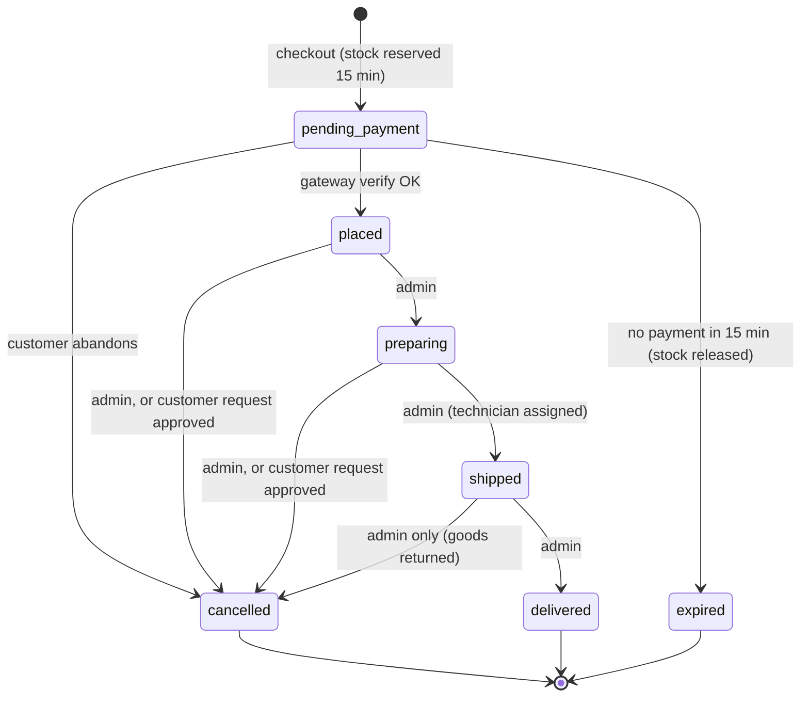
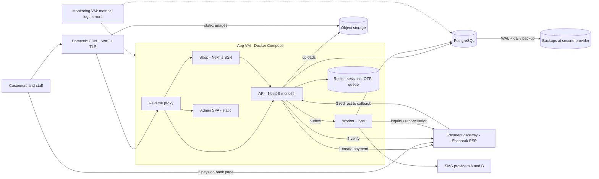
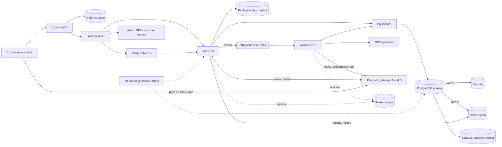
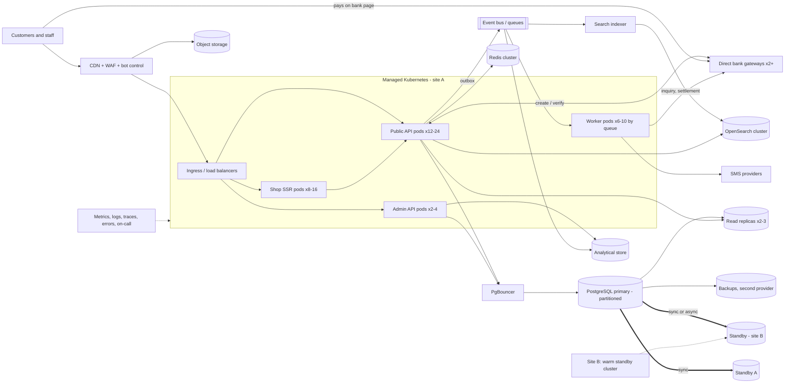

# Emdad Oxygen — production architecture, requirements and estimates per level

**Prepared by:** Head of Engineering, with four review agents (shop audit, panel audit, global cloud pricing, Iran market constraints).
**Date:** 16 Nov 2026. **Code reviewed:** commit `faec1d9` (`shop/index.html`, `panel/index.html`, `server.js`, `db.json`, `docs/`).
**Status:** audit and proposal only. No application code was changed. Nothing should be built until this is approved (section 17 lists the decisions needed).

**How to read the evidence**

| Mark | Meaning |
|---|---|
| `server.js:NN`, `panel/index.html:NN` | line in the committed file |
| `shop T:NN` | line in the *unpacked* shop source. The shop's app code sits on one JSON-encoded line (`shop/index.html:582`), so it can only be cited after unpacking |
| **[V]** | price or fact read from an official source |
| **[S]** | read from a search snippet of the official page; the page itself could not be opened from this environment |
| **[3P]** | third-party source only |
| **[A]** | our assumption — to be confirmed by the business or by load tests |

**Confidence warning on prices.** Only AWS prices are verified (AWS Price List API, Frankfurt). Hetzner, DigitalOcean, Cloudflare and every Iranian provider's pricing page was unreachable from this environment; those figures come from snippets or third parties and must be re-checked before budgeting. Toman figures use ≈ 266,000 T/USD (free market, 16 Nov 2026 [3P]); that rate moved from ≈ 186,000 in August, so treat USD equivalents as indicative.

---

## 1. Executive summary

1. **What exists is a well-designed prototype, not a product.** The customer flows, Persian copy, design tokens and accessibility work are good and worth keeping. The technical base is not: a zero-dependency Node server that keeps the whole database in one JSON file, in-memory logins, one shared admin password, a fixed OTP code and a **simulated payment that the browser itself declares "paid"** (`server.js:243-251`, `shop T:4384-4460`).
2. **The real product is narrower than the brief's template.** It is a single-seller shop (8 products, 3 hard-coded categories, no variants) plus two service-request forms (cylinder refill, used equipment) and technician assignment. It is not a marketplace and has no time-slot booking system. We size and design for that, and note where the brief's larger numbers would change things.
3. **Target market is Iran, and that decides the infrastructure.** AWS, Google Cloud, Azure and DigitalOcean do not serve Iranian businesses [3P], and during 2026 international connectivity was cut for months while the domestic network stayed up [3P]. Everything on the request path must be hosted in Iran, with no foreign runtime dependencies. Foreign prices are given for comparison only.
4. **Recommended stack:** TypeScript monorepo — Next.js storefront (server-rendered for SEO), React admin SPA, NestJS modular monolith, PostgreSQL, Redis, S3-compatible object storage, Docker. Kubernetes only at Level 3. No microservices at any level unless a measured trigger fires (section 16).
5. **Effort to a production Level 1 launch:** about **45–60 person-weeks** — a team of 4 for roughly 4–5 months [A]. Compliance (eNamad, payment gateway onboarding, medical-device permits) is more likely to delay launch than engineering.
6. **Monthly infrastructure, recommended configuration, hosted in Iran** (USD equivalent, low confidence): Level 1 ≈ **$50–85**, Level 2 ≈ **$400–600**, Level 3 ≈ **$3,300–4,800**. The same on AWS Frankfurt (verified list prices): ≈ $515, ≈ $5,000, ≈ $26,000.
7. **Infrastructure is not the largest running cost.** At Level 1, gateway fees (≈ $190/month) and SMS (≈ $20/month) already exceed hosting. At Level 3 they are ≈ 10–20× the hosting bill unless the shop moves to a direct bank gateway (section 12.4).

### Comparison across the three levels

| | Level 1 | Level 2 | Level 3 |
|---|---|---|---|
| Peak API load (brief) | 50–100 RPS | 500–1,000 RPS | 5,000–10,000 RPS |
| Orders per day (brief) | 20–200 | 500–5,000 | 10,000–100,000 |
| Application | Modular monolith, 1–2 instances | Same monolith, 4–6 instances, separate workers | Same codebase, 20–40 pods; extract a service only on a trigger |
| Database | PostgreSQL, 1 node (+ standby for HA) | Primary + sync standby + 1 read replica, PgBouncer | Primary + 2 standbys + 2–3 replicas, partitioned tables |
| Cache / queue | Redis (or PostgreSQL only at minimum) | Redis primary + replica | Redis cluster; Kafka/NATS only if event volume needs it |
| Search | PostgreSQL trigram search | PostgreSQL; a search engine only if catalogue > ~50k | OpenSearch cluster |
| Runtime | Docker Compose on 1–3 VMs | Docker on VMs, or managed Kubernetes | Managed Kubernetes |
| Team [A] | 4 | 6–9 | 15–30 |
| Hosting, recommended (Iran, USD eq.) | $50–85 | $400–600 | $3,300–4,800 |
| Hosting, recommended (AWS, verified) | ≈ $515 | ≈ $5,000 | ≈ $26,000 |
| Availability target | 99.5% | 99.9% | 99.95% |

---

## 2. Existing project audit

### 2.1 What is in the repository

| File | Size | What it is |
|---|---|---|
| `shop/index.html` | 1.72 MB, 585 lines | Customer app. A "bundled page" export of a proprietary runtime (`dc-runtime`): React 18.3.1, GSAP 3.13.0 + 7 plugins, Leaflet 1.9.4 and 13 font files inlined, unpacked in the browser (`shop/index.html:436-571`). Real app source ≈ 4,070 lines / 338 KB — about 20% of the file |
| `panel/index.html` | 304 KB, 1,265 lines | Admin panel. Vanilla JS, no framework; renders by string concatenation into `innerHTML`. 58% of the file is base64 fonts (`panel/index.html:11-13`); app JS is lines 310–1263 |
| `server.js` | 31 KB, 530 lines | Zero-dependency Node HTTP server: static files + REST API over a JSON file |
| `db.json` | 7 KB | Seed catalogue: 8 products, 2 services |
| `docs/api.md`, `docs/review/*` | — | API contract and three earlier review reports |

There is no build step, no tests, no linter, no CI configuration, no Dockerfile and no dependency manifest beyond an empty `package.json`. The original build sources were removed from the repository (README, "Source").

### 2.2 Features that actually exist

**Shop (18 live screens, 5 bottom sheets)**

| Feature | Status | Evidence |
|---|---|---|
| Home, product list, product detail | Implemented | `shop T:1505, 1600, 1671` |
| Search, 3 categories, in-stock filter, 3 sorts | Implemented, all in the browser | `shop T:2794, 3332, 4536-4543` |
| Cart, wishlist | Implemented; synced with `PUT /api/carts|wishlists/<id>` | `shop T:1743, 2527, 3688-3710` |
| Login by phone + one-time code | Implemented against the server, but the code is the same for every phone | `server.js:35, 441-469` |
| Addresses with map pin | Implemented; map tiles come from a foreign CDN (`basemaps.cartocdn.com`) | `shop T:2475, 3273` |
| Checkout with discount code | Implemented; one code, `EMDAD10`, hard-coded on both sides | `shop T:4793`, `server.js:209` |
| Payment | **Simulated.** A card form in our own page; the "dynamic PIN" is generated in the browser; after a 1.2 s timer the browser posts the order with `paid: true` | `shop T:2154-2186, 4394-4424` |
| Order history, detail, 4-stage tracking | Implemented | `shop T:2404, 2212, 3339` |
| Cancel *request* (stage ≤ 2) | Implemented; only sets a flag for the admin | `server.js:374-379` |
| Refill request (photos, gas, volume, quantity, delivery type, optional day/slot) | Implemented | `shop T:1909, 4250-4279` |
| Used-equipment request (photos, asking price, description) | Implemented | `shop T:2005, 4280-4293` |
| Delivery day/slot | A label only: 4 days × 4 fixed slots, no capacity or availability check | `shop T:3771-3794` |
| Notifications, reviews, product photos, shipping fee, tax, invoices, product URLs | **Absent** | no matches in source |

**Admin panel (login + 10 views, about 12 dialogs/drawers)**

| Feature | Status | Evidence |
|---|---|---|
| Dashboard (attention list, 4 stat cards, 14-day revenue chart, pipelines) | Implemented | `panel/index.html:666` |
| Orders: list, detail, stage +1, cancel, edit address/notes, hard delete | Implemented | `panel/index.html:724, 901, 1090, 1099, 1150` |
| Refunds | Partial: only flips `refund_pending → refunded`; no amount, no partial refund, no gateway call | `panel/index.html:1107`, `server.js:388-393` |
| Service requests, technicians, technician assignment | Implemented | `panel/index.html:735, 741, 882, 1012` |
| Products and services CRUD | Implemented (title, category, price, stock, specs, active) | `panel/index.html:760, 769, 1056` |
| Stock | An absolute number in the product form; no adjustment log; global low-stock threshold of 3 | `panel/index.html:338, 763` |
| Customers | List, drawer, rename, delete | `panel/index.html:776, 926` |
| Payments list, activity log, CSV export (orders, payments) | Implemented | `panel/index.html:751, 785, 1117` |
| Categories, variants/attributes, product images, promotions, staff accounts and roles, business settings, reports, manual order entry | **Absent** | categories hard-coded at `panel/index.html:328` |

**Server**

| Capability | Status | Evidence |
|---|---|---|
| Role-based access (guest / user / admin) for generic CRUD | Implemented | `server.js:285-303` |
| Atomic order creation: validate items, check stock, recompute totals and discount, decrement stock | Implemented — correct for one process | `server.js:211-254` |
| Order/request lifecycle: stage +1 only, cancel restocks and marks payment `refund_pending` | Implemented | `server.js:200-207, 257-282` |
| Atomic file write with in-memory rollback | Implemented | `server.js:81-114` |
| Login rate limits (5 failures / 10 min) | Implemented, in memory | `server.js:142-149, 433, 444, 453` |

### 2.3 Risks and technical debt (highest first)

| # | Finding | Evidence | Why it blocks production |
|---|---|---|---|
| R1 | **Payment is asserted by the browser.** The server records a payment as `paid` because the request body says so | `server.js:243, 247-251` | Anyone can place "paid" orders for free |
| R2 | **The shop shows a card form and collects card number and CVV2.** | `shop T:2154-2186` | In Iran card data may only be entered on the bank's (Shaparak) page. The form must be deleted, not ported |
| R3 | **The database is one JSON file, rewritten in full on every write**, with all writes queued one at a time | `server.js:81-96, 101-114` | Write cost grows with total data; one process only; no queries, indexes or constraints |
| R4 | **Uploaded photos are stored inside that JSON file** as base64, up to 8 MB per request | `server.js:32`, `shop T:4239` | Database size explodes; every poll and write carries the photos |
| R5 | **Unauthenticated writes.** Guests may POST to `activity` and `sessions` and PUT 8 MB documents to `carts/guest_*` with no rate limit | `server.js:288-291` | Anyone can fill the disk and slow every write (follows from R3) |
| R6 | **Logins live in process memory** | `server.js:117-125` | A restart signs everyone out; a second instance cannot share sessions |
| R7 | **One shared admin password**, default `emdad`; the same string is in the panel source for offline mode | `server.js:33`, `panel/index.html:323` | No per-person accountability, no MFA, no roles |
| R8 | **OTP is a fixed code**; in production mode the code is printed to the server console, no SMS provider | `server.js:35, 446` | No real customer authentication |
| R9 | **Rate limits key on the socket address** | `server.js:432` | Behind any proxy or CDN all users share one address — one attacker locks out every admin login |
| R10 | **Client-chosen identifiers**: order number, request code, payment reference | `server.js:215, 248`, `shop T:4229, 4421, 4433` | Guessable, collidable, forgeable |
| R11 | **Schema-less writes**: unknown fields from the client are stored as sent | `server.js:238, 341, 382` | No data integrity; storage abuse |
| R12 | **Admin panel downloads the entire database every 10 s**; the shop polls the catalogue every 15 s | `panel/index.html:431, 1252`, `shop T:3677` | Does not scale past demo data; inflates API traffic |
| R13 | **Audit trail is written by the client** and guests can post to the same collection | `panel/index.html:524-526`, `server.js:290` | Entries can be forged or silently dropped |
| R14 | **Tokens in browser storage** (`localStorage` in the shop, `sessionStorage` in the panel) | `shop T:3433`, `panel/index.html:324` | Any script injection steals the session |
| R15 | **Hard-deleting an order does not return stock** | `server.js:313-328` | Stock drifts; orders should never be hard-deleted anyway |
| R16 | **Shop is mobile-only, has no URLs and no SEO**: 430 px column, route kept in memory, document title "Bundled Page" | `shop T:1506, 2918`, `shop/index.html:2-5` | No deep links, refresh returns to home, invisible to search engines |
| R17 | **1.7 MB single HTML file**, ~300 KB of render-blocking script, 8 animation plugins and the map library loaded eagerly | `shop/index.html:20-412` | Slow first load on mobile networks; nothing is cacheable separately |
| R18 | **Business rules are written three times** (server, panel offline mode, shop offline mode) | `panel/index.html:462-491`, `shop T:4471` | Rules drift apart |
| R19 | **No tests, CI, containers, logs or metrics** | repository contents | No safe way to change or operate the system |

No live script-injection hole was found in either front end: the panel escapes every user value it interpolates (`panel/index.html:382`) and the shop's three `innerHTML` uses are static. In the panel that safety depends on discipline, not on the rendering method.

### 2.4 Keep, refactor, replace

| | Shop | Panel | Server |
|---|---|---|---|
| **Keep** | Design tokens, light/dark (`shop T:903-990`); all Persian copy and validation messages; flows and their edge cases (stock clamp, duplicate-order retry, login-then-resume, cart merge); helpers (digit normalisation, phone validation, Jalali dates, photo downscaler); accessibility behaviours | Design tokens (`panel/index.html:18-38`); component vocabulary; copy, error and stage maps; confirm texts; attention queue; focus management; CSV formula guard | The API's *rules*: lifecycle, cancel/restock, refund-pending, role matrix, error codes (`docs/api.md`) — they become the acceptance tests of the new backend |
| **Refactor** | Split into components, typed API client, CSS classes from the tokens; dates as ISO; photos as file uploads; one font family, subset | Filters and record ids in the URL; one set of stage names (the dashboard uses a fourth set, `panel/index.html:699`); export respects filters | — |
| **Replace** | `dc-runtime` packaging; in-memory routing; token in `localStorage`; simulated payment and card form; offline demo mode; 15 s polling; add a desktop layout | Whole-database fetch and poll; shared password; client-written audit log; string rendering; hard-coded categories | All of it: file storage, in-memory sessions, generic CRUD, fixed OTP, single password |

Porting scope: shop ≈ 45–50 units (18 screens, 5 sheets, ~25 shared components); panel ≈ 35–40 units (11 screens, ~12 overlays, ~15 shared components), plus the admin features that do not exist yet.

### 2.5 Unclear business rules found in the code

1. The seed data names the `used` service "تعمیر تجهیزات" (equipment repair) (`db.json`), but the shop's form for it asks for an *asking price* — a sale of used equipment (`shop T:2005`). Which is it?
2. Refill requests carry no price and no payment. Is the price agreed by phone and paid in person?
3. Shipping shows "arranged by phone" and there is no fee or tax line (`shop T:1787`). VAT is 10% in 1405 [3P]; whether medical items are exempt is unverified.
4. Orders can be marked delivered without proof; cancellation after shipping is admin-only with no return flow.
5. Admin-added services only open the contact sheet (`shop T:4947`).

---

## 3. Business workflows and commerce assumptions

### 3.1 What we are designing for

| Model | Applies? | Basis |
|---|---|---|
| Physical products, single seller, stock per product | **Yes** | `db.json`, `server.js:211-254` |
| Variants / SKUs | Not today. The model allows one default SKU per product so variants can be added without a migration | no variant code |
| Digital products | No | — |
| Marketplace / multiple sellers | No | — |
| Service **requests** reviewed by staff (refill, used equipment) | **Yes** | `shop T:4250-4293` |
| Time-slot **bookings** with capacity | **No.** Delivery windows are labels. We add an optional per-window capacity counter; a calendar/booking engine is not justified | `shop T:3771-3794` |
| Technician dispatch | Yes, manual assignment by admin | `panel/index.html:882-886` |

### 3.2 Order state machine (target)

The four existing stages are kept; a payment step is added in front because payment becomes real.

Rules carried over from `server.js:257-282`: advance one stage at a time, no un-cancel, cancel restocks, every transition is appended to a history table with who and when.

**Payment states:** `initiated → redirected → paid` | `failed` | `expired`; then `refund_pending → refunded` | `refund_failed`. Partial refunds are separate refund rows against one payment.

**Service request states** (existing labels, `panel/index.html:334-335`): refill — submitted → cylinder collected → charging → delivered; used equipment — submitted → under review → priced → completed; either can be cancelled before the last stage.

### 3.3 Payment flow for Iran

Iranian gateways work by redirect: the customer enters card number, CVV2, expiry and a dynamic one-time password on the bank's page; the browser is sent back to our callback; **our server must then call the gateway's verify API**, otherwise the payment is reversed. There is generally no webhook — only callback plus verify and inquiry APIs [A, general practice; confirm per gateway].

1. `POST /checkout` with an idempotency key → in one database transaction: create order `pending_payment`, reserve stock, create payment `initiated` with the server-computed amount.
2. Server requests a payment token from the gateway, stores it (unique), returns the redirect URL.
3. Customer pays on the bank page and returns to `/payments/callback`.
4. Server locks the payment row, calls **verify**, compares amount and order, marks `paid`, moves the order to `placed`, commits the reservation, queues notifications. Verify is idempotent: a repeated callback finds the row already `paid` and does nothing.
5. **Reconciliation job** every 2 minutes: for payments stuck in `redirected` longer than 3 minutes, call the gateway's inquiry API and apply the same step 4, or mark `failed`.
6. **Late success** (verify succeeds after the reservation expired): try to reserve again; if stock is gone, mark the order `cancelled` and open a refund automatically.
7. Daily settlement check: compare the gateway's settlement report with our `paid` rows; differences go to an admin queue.

### 3.4 Preventing overselling and double allocation

- Stock lives in PostgreSQL. Reservation is one conditional statement inside the checkout transaction:
  `UPDATE inventory SET available = available - $qty WHERE sku_id = $1 AND available >= $qty` — zero rows updated means out of stock. A `CHECK (available >= 0)` constraint is the backstop.
- Each reservation is a row with `expires_at`; a job releases expired ones. Payment success converts it to a committed deduction.
- Multi-item orders update SKUs in a fixed order (by id) to avoid deadlocks.
- Delivery windows (if capacity is enabled): same pattern on a `(date, window)` counter row with a unique constraint.
- Technician double-assignment is a staffing choice, not a hard rule today (the panel shows open-job counts, `panel/index.html:871`); no lock is needed.
- Redis is never the source of truth for stock.

---

## 4. Traffic and transaction model

### 4.1 Definitions

| Term | Definition used here |
|---|---|
| Page view | A human page view. Bots are counted separately: assume +25–40% extra HTML requests at the CDN [A] |
| Static/CDN requests | Images, scripts, fonts — served by the CDN, not counted in API RPS |
| API request | A request that reaches the application (browser API calls plus server-side rendering calls) |
| Average | Daily total ÷ 86,400 |
| Peak hour | Busiest hour ≈ 10–12% of the daily total [A] |
| Burst | Busiest 5 minutes of a campaign ≈ 4–8× the peak-hour rate [A] |
| Completed order | Payment verified. A checkout attempt creates an order in `pending_payment`; a payment attempt is one redirect to the gateway |

### 4.2 Are the brief's numbers consistent?

Ratios computed from the brief's "typical" column (min and max rows behave the same way):

| Ratio | Level 1 | Level 2 | Level 3 | Comment |
|---|---:|---:|---:|---|
| DAU ÷ registered | 12% | 20% | 16% | High for commerce (2–10% is common). Plausible only if many daily users are guests |
| Page views ÷ DAU | 16.7 | 20.0 | 12.5 | Plausible (≈ 1.4 sessions × 9–14 pages) |
| API requests ÷ page view (from average RPS) | 17.3 | 8.6 | 8.6 | **Level 1 is inconsistent with Levels 2–3.** A server-rendered shop makes ≈ 3–6 API calls per page. 17 only fits the current prototype, which polls every 15 s |
| Peak RPS ÷ average RPS | 7.5 | 7.5 | 7.5 | This is a campaign burst, not a daily peak (daily peaks are 2–3×). We treat "peak RPS" as a 5-minute burst |
| Peak RPS ÷ peak concurrent users | 0.38 | 0.21 | 0.21 | A browsing user generates ≈ 0.15–0.2 requests/s. Level 1 is ≈ 2× high |
| Orders ÷ DAU | 3.3% | 4.0% | 5.0% | Upper end of realistic. At 1.2–2.5% of sessions the typical values would be 50–105, 840–1,750 and 13,000–28,000 per day |

Derived load using our own assumptions (1.4 sessions per DAU, 6-minute sessions, 75% of page views needing fresh data, 5 API calls per such page, peak hour = 10% of the day, burst = 4×) [A]:

| | L1 typ | L1 max | L2 typ | L2 max | L3 typ | L3 max |
|---|---:|---:|---:|---:|---:|---:|
| Average concurrent users | 18 | 29 | 292 | 583 | 4,667 | 11,667 |
| Peak-hour concurrent users | 42 | 70 | 700 | 1,400 | 11,200 | 28,000 |
| Average API RPS | 2.2 | 4.3 | 43 | 87 | 434 | 868 |
| Peak-hour API RPS | 5.2 | 10 | 104 | 208 | 1,042 | 2,083 |
| 5-minute burst API RPS | 21 | 42 | 417 | 833 | 4,167 | 8,333 |
| **Brief's peak RPS** | 75 | 100 | 750 | 1,000 | 7,500 | 10,000 |

**Conclusion.** The brief's peak RPS is 1.2–3.5× our derived burst — a reasonable safety margin, so we **size for the brief's peak RPS** and treat the brief's average RPS as an upper bound. The order volumes are kept as design targets but are optimistic. Catalogue size in the brief (500 to 5,000,000 products) is unrelated to this business, which has 8 products; it only affects the search decision (section 7.4). Registered-account count is used for storage sizing only.

### 4.3 Transaction model

Assumptions [A]: 72% of payment attempts succeed; 6% of completed orders are cancelled; 3% are refunded; ≈ 25 row-writes per order over its life (order, items, reservation, payment and its updates, 4–5 history rows, notifications, audit); 8 background jobs per order; 3 SMS per order plus one OTP SMS per day for 12% of DAU; peak hour = 12% of daily orders; burst = 8×.

| Per day unless stated | L1 min | L1 typ | L1 max | L2 min | L2 typ | L2 max | L3 min | L3 typ | L3 max |
|---|---:|---:|---:|---:|---:|---:|---:|---:|---:|
| Completed orders (brief) | 20 | 100 | 200 | 500 | 2,000 | 5,000 | 10,000 | 40,000 | 100,000 |
| Payment attempts | 28 | 139 | 278 | 694 | 2,778 | 6,944 | 13,889 | 55,556 | 138,889 |
| Cancelled | 1 | 6 | 12 | 30 | 120 | 300 | 600 | 2,400 | 6,000 |
| Refunded | 1 | 3 | 6 | 15 | 60 | 150 | 300 | 1,200 | 3,000 |
| Orders/s, peak hour | 0.001 | 0.003 | 0.007 | 0.017 | 0.067 | 0.17 | 0.33 | 1.3 | 3.3 |
| Orders/s, burst | 0.01 | 0.03 | 0.05 | 0.13 | 0.53 | 1.3 | 2.7 | 10.7 | 26.7 |
| Payment attempts/s, burst | 0.01 | 0.04 | 0.07 | 0.19 | 0.74 | 1.9 | 3.7 | 14.8 | 37 |
| Row-writes from orders | 500 | 2,500 | 5,000 | 12,500 | 50,000 | 125,000 | 250,000 | 1.0 M | 2.5 M |
| Background jobs | 160 | 800 | 1,600 | 4,000 | 16,000 | 40,000 | 80,000 | 320,000 | 800,000 |
| SMS (orders + OTP) | 180 | 660 | 1,200 | 3,900 | 12,000 | 27,000 | 54,000 | 216,000 | 540,000 |
| Gateway callbacks + inquiry calls | ≈ 2 per payment attempt | | | | | | | | |
| Order-history reads | 450 | 1,350 | 2,250 | 9,000 | 22,500 | 45,000 | 90,000 | 360,000 | 900,000 |

Service requests are not in the brief's numbers. Assume 10–30% of order volume [A]; each carries up to 5 photos of ≈ 300 KB.

**What this tells us.** Even at Level 3 maximum, order writes average ≈ 29 rows/s with bursts of ≈ 700 rows/s — well inside one PostgreSQL primary. **Writes are never the bottleneck; read traffic and the gateway are.** Stock contention matters only when one product takes most of a burst: 27 checkouts/s on one stock row with a ≈ 5 ms transaction is still fine, to be proven by the contention test in section 14.

---

## 5. Frontend comparison and recommendation

| Option | SEO | First-load performance | Dev speed | Admin fit | Shop fit | Hosting | Hiring in Iran [A] | Verdict |
|---|---|---|---|---|---|---|---|---|
| Keep current HTML/JS | None (client-rendered from a JSON string) | Poor (1.7 MB) | Editing a packed export of a proprietary runtime | Workable short-term | No | Static | — | Reject for the shop; the panel can run unchanged as a stopgap |
| React SPA (Vite) | Weak | Good after load | Fast | **Best** | Weak (no SSR) | Static files | Large pool | **Admin panel** |
| **Next.js** (React) | Strong: SSR/ISR per product URL | Good | Fast; reuses the React knowledge already implied by the shop | Fine but unnecessary | **Best** | One Node container, self-hosted (Vercel is not an option) | Large pool | **Storefront** |
| Nuxt (Vue) | Strong | Good | Fast | Good | Good | Same as Next.js | Good pool | Equal technical choice; pick it only if the team is Vue-first |
| Angular | Adequate with SSR | Heavier | Slower for a small team | Good for large back-offices | Heavy | Same | Smaller pool | Not for a 4-person team |

**Rendering plan for the shop:** catalogue, product and content pages server-rendered and cached with incremental regeneration (revalidate on product change, 60 s fallback); cart, checkout, account and order pages rendered per user and never cached. This also removes the 15-second catalogue polling.

**Two applications, one repository.**
- `apps/shop` (Next.js) and `apps/admin` (React SPA) are separate deployments: different audiences, different security posture (the admin can sit behind an IP allow-list or VPN), different release rhythm.
- Shared packages: `packages/ui` (design tokens from both prototypes, RTL components), `packages/api-client` (generated from the backend's OpenAPI document), `packages/schemas` (validation shared by front and back ends), `packages/fa-utils` (digit normalisation, phone, Jalali dates — lifted from the prototypes).
- Monorepo with pnpm workspaces. One team, shared types and one pull request per feature outweigh the cost of a larger repository.

**Frontend requirements to add:** real URLs for every product and order; a desktop layout (none exists); product photos; fonts served as one subsetted family; map tiles and every other asset from domestic hosts; no third-party script at runtime.

---

## 6. Backend and application architecture

### 6.1 Language and framework

| Criterion | Java + Spring Boot | **Node.js + NestJS** | Go | .NET |
|---|---|---|---|---|
| Raw throughput | High | Medium (I/O-bound work is fine; scale by adding instances) | Highest | High |
| Productivity for a 4-person team | Medium | **High — one language across shop, admin and API; shared schemas and types** | Medium (more hand-written code) | Medium-high |
| Ecosystem (ORM, queues, auth, validation) | Very mature | Mature | Good, thinner | Very mature |
| Fit with existing code | None | **Existing server and helpers are JavaScript** | None | None |
| Background jobs | Mature | BullMQ / pg-boss | Good | Mature (Hangfire) |
| Memory per instance | 0.5–1 GB | 150–300 MB | 30–80 MB | 150–300 MB |
| Hiring in Iran [A] | Good, mostly enterprise | Good | Smaller, growing | Good, mostly enterprise |

**Recommendation: NestJS on Node.js LTS with TypeScript, PostgreSQL through Prisma or Drizzle, BullMQ for jobs.** Node's weakness (CPU-bound work) does not apply to this workload. If the company already employs a strong Java or .NET team, either is an equally valid choice and nothing else in this document changes. Go is justified only for a later extracted hot path.

### 6.2 Architecture style per level

| Style | Level 1 | Level 2 | Level 3 |
|---|---|---|---|
| **Modular monolith** | **Yes** | **Yes** (more instances, separate worker process) | **Yes, as the default** |
| Distributed monolith (services sharing one database) | Avoid | Avoid | Avoid — it has the costs of both |
| Microservices | Premature | Premature | Only for a module that hits a measured trigger (section 16.3) |
| Event-driven | In-process events + **outbox table** + job queue | Same | A broker (Kafka or NATS) only if event consumers multiply |

### 6.3 Modules (adapted to this product)

| Module | Owns | Notes |
|---|---|---|
| Identity & access | Customers (phone + OTP), staff accounts, roles, sessions, MFA | Replaces `server.js:117-156` |
| Catalogue | Products, categories, images, specs | One default SKU per product; variants later |
| Inventory | Stock, reservations, stock movements | The only module that changes stock |
| Pricing & promotions | Price, discount codes, shipping fee, VAT | Starts as a small module; `EMDAD10` becomes data |
| Cart & checkout | Cart, wishlist, address book, checkout orchestration | |
| Orders | Order, items, state machine, cancel requests | Rules from `server.js:257-282` |
| Payments | Gateway adapters, verify, reconciliation, refunds | Gateway behind an interface; two providers |
| Service requests | Refill and used-equipment requests, photos, quotes | Not a booking engine |
| Dispatch | Technicians, assignment, delivery windows | |
| Notifications | SMS, later web push; templates | Two SMS providers with failover |
| Back-office & reporting | Dashboard aggregates, exports, audit log, settings | Server-side aggregates replace whole-database polling |

Not created: marketplace/vendors, bookings calendar, digital delivery, reviews — the business does not need them.

Module rules: a module's tables are private to it; other modules call its public service or react to its events; cross-module reads for reporting go through database views. This is what makes a later extraction possible without a rewrite.

---

## 7. Database and data architecture

### 7.1 Engine choices

| Engine | Role | Decision |
|---|---|---|
| **PostgreSQL** | Primary transactional store | **Yes, from day one.** Transactions, constraints, conditional updates, row locks, JSON columns for specs, trigram search, partitioning, replication; offered as a managed service by Iranian providers [S] |
| MySQL | Alternative primary | Would work. PostgreSQL preferred for partial indexes, richer constraints and transactional schema changes |
| MongoDB | — | No. Orders, payments and stock need multi-row transactions and constraints; the current JSON file already shows the cost of schema-less storage (R11) |
| Redis | Sessions, OTP codes, rate limits, job queue, hot cache | Recommended from Level 1; **never** the source of truth for stock or payments |
| OpenSearch / Elasticsearch | Search | Not at launch (section 7.4) |
| S3-compatible object storage | Product images, request photos, exports, backups | **Yes, from day one** — removes base64 photos from the database (R4) |

### 7.2 Core schema (launch)

| Area | Tables | Key constraints and indexes |
|---|---|---|
| Users | `customers`, `staff`, `roles`, `staff_roles`, `sessions`, `otp_challenges` | unique `customers.phone`; OTP stored hashed with expiry and attempt count |
| Catalogue | `categories`, `products`, `skus`, `product_images` | unique slug; index `(category_id, active, sort)`; trigram index on normalised title |
| Inventory | `inventory` (one row per SKU), `stock_reservations`, `stock_movements` | `CHECK (available >= 0)`; index `stock_reservations(expires_at) WHERE status = 'held'` |
| Pricing | `discount_codes`, `discount_redemptions`, `shipping_rules`, `tax_rates` | unique `(code)`; unique `(code_id, order_id)` |
| Cart | `carts`, `cart_items`, `wishlist_items`, `addresses` | unique `(cart_id, sku_id)` |
| Orders | `orders`, `order_items`, `order_status_history`, `cancel_requests` | server-generated unique `order_no`; index `(customer_id, created_at DESC)`; index `(status, created_at)`; items copy title and unit price at purchase time |
| Payments | `payments`, `payment_events`, `refunds` | unique `(gateway, gateway_token)`; unique `idempotency_key`; amounts as integers in Rial |
| Services | `service_types`, `service_requests`, `service_request_photos`, `service_request_history` | index `(customer_id, created_at DESC)`, `(status, created_at)` |
| Dispatch | `technicians`, `assignments`, `delivery_windows` | unique `(date, window)` |
| Cross-cutting | `outbox`, `notifications`, `audit_log`, `idempotency_keys`, `settings` | `audit_log` is append-only and written by the server only |

Design rules: normalised (third normal form) for transactional tables; JSON columns only for free-form specs; money as integer Rial; timestamps as `timestamptz` (Jalali is a display concern; one time zone, Asia/Tehran, so no zone logic beyond that); deletes are soft for anything referenced by an order.

### 7.3 Concurrency, pooling, migrations

- **Isolation:** default READ COMMITTED plus conditional updates and `SELECT … FOR UPDATE` on the payment row during verify. No SERIALIZABLE needed.
- **Optimistic control** (a `version` column) on admin-edited records such as products and orders, to stop two staff overwriting each other; **pessimistic row locks** only in checkout and payment verify.
- **Idempotency:** `Idempotency-Key` header on checkout, payment initiation, refunds and service-request creation, stored with the response for 24 h.
- **Pooling:** 10–20 connections per app instance at Level 1; PgBouncer in transaction mode from Level 2; database `max_connections` 200–400.
- **Migrations:** versioned, forward-only, run in CI before deploy; additive first, destructive in a later release (expand → migrate → contract).

### 7.4 Search

| Stage | Approach | Trigger to move on |
|---|---|---|
| Today (8 products) | In the browser | — |
| Levels 1–2 | PostgreSQL: normalised text (ی/ک, ZWNJ, digits — logic already in `shop T:3326`) + `pg_trgm` index | Search p95 > 200 ms, or catalogue > ~50,000 items, or facets/typo-tolerance required |
| Level 2 upper / Level 3 | OpenSearch (or Meilisearch, simpler), fed from the outbox | — |

### 7.5 Caching, replication, partitioning, retention

| Topic | Level 1 | Level 2 | Level 3 |
|---|---|---|---|
| Cache | CDN + Next.js page cache for catalogue | + Redis for catalogue and settings objects | + per-user caches where measured |
| Replication | Nightly base backup + continuous WAL archive; standby only in the HA variant | Synchronous standby + 1 asynchronous read replica (reports, history) | 2 standbys + 2–3 read replicas |
| Partitioning | None | `audit_log`, `payment_events`, `notifications` by month | + `orders`, `order_items`, history tables by month |
| Sharding | No | No | No. Total order data at Level 3 maximum is ≈ 180 GB/year (section 11) |
| Analytics | Reports from the primary | Reports from the read replica | Separate analytical store (ClickHouse) fed by change stream |
| Retention [A] | Orders, payments and invoices 10 years (confirm legal period); audit log 2 years online then archived; activity events 90 days; abandoned carts 30 days; request photos 1 year after completion; OTP rows 24 h | same | same |
| Backup | Daily full + WAL (point-in-time recovery), encrypted, copied to a **second domestic provider**; restore drill monthly | same, restore drill monthly | + cross-site standby |

**Launch requirements:** PostgreSQL, object storage, backups with tested restore, Redis (or PostgreSQL-only at the minimum tier). **Later:** PgBouncer, replicas, partitioning, search engine, analytical store.

---

## 8. Level 1 architecture

**Requirements:** 99.5% availability; up to 100 RPS burst; up to 200 orders/day; recovery within 4 h with at most 15 min of data loss; one engineer can operate it.

| Component | Decision |
|---|---|
| DNS, CDN, WAF, TLS | Domestic CDN with managed WAF rules and certificates — **essential** |
| Load balancer | Not at minimum (one VM); provider load balancer in the HA variant |
| Reverse proxy | Caddy or Nginx on the VM — essential |
| Application | Docker Compose: `shop` (Next.js), `api` (NestJS), `worker` (same image, job mode) |
| API gateway | Premature — the reverse proxy routes `/api` |
| Database | PostgreSQL on its own VM or the provider's managed service — essential |
| Redis | Recommended (sessions, OTP, rate limits, queue). At minimum tier, PostgreSQL does all four |
| Message broker | Premature — BullMQ on Redis plus the outbox table |
| Search engine | Premature |
| Object storage | Essential |
| Monitoring, logs, errors | Prometheus + Grafana + Loki + self-hosted GlitchTip on a small VM; external uptime probe — essential (SaaS equivalents are blocked or unreachable from Iran) |
| CI/CD | Self-hosted GitLab or Gitea with runner and private registry inside Iran, mirrored to GitHub — essential |
| Kubernetes, serverless | Premature |

---

## 9. Level 2 architecture

**Requirements:** 99.9% availability; up to 1,000 RPS burst; up to 5,000 orders/day; recovery within 1 h with at most 1 min of data loss; no single point of failure; zero-downtime deploys.

| Component | Change from Level 1 |
|---|---|
| Load balancer | **Essential** — provider load balancer (or two HAProxy nodes) |
| Application | Shop and API on separate instance groups, 2+ each; workers separate; rolling deploys |
| Database | Primary + synchronous standby with automatic failover (managed service, or Patroni) + 1 read replica; PgBouncer |
| Redis | Primary + replica with automatic failover |
| Search | Optional — only on the trigger in section 7.4 |
| Message broker | Still not needed; split queues by priority (payments, notifications, exports) |
| Observability | Adds tracing (OpenTelemetry) on checkout and payment paths; on-call rotation |
| Orchestration | Docker on VMs with an automated deploy works. Managed Kubernetes becomes reasonable once there are > ~10 app instances or > ~6 engineers deploying; optional here |
| WAF | Adds rate rules per path and bot management |

---

## 10. Level 3 architecture

**Requirements:** 99.95% availability; up to 10,000 RPS burst; up to 100,000 orders/day; recovery within 15 min with near-zero data loss; survive the loss of one data centre; many teams deploying independently.

| Component | Change from Level 2 |
|---|---|
| Orchestration | **Managed Kubernetes** justified: autoscaling, many instances, many deployers |
| Application | Still one codebase, deployed as separate workloads (public API, admin API, workers by queue) with separate scaling. Extract a service only on a trigger |
| Database | Larger primary, 2 standbys (one in a second site), 2–3 read replicas, monthly partitions; analytical store for reports |
| Redis | Cluster (3 shards × 2) |
| Search | OpenSearch cluster, 3 data nodes + 3 small managers |
| Message broker | Kafka or NATS justified if several independent consumers of order/stock events exist (search indexing, analytics, notifications, fraud); otherwise keep Redis queues |
| API gateway | Justified only if services are extracted or third-party API access is opened; otherwise the ingress controller suffices |
| Disaster recovery | Warm standby in a second domestic data centre; tested failover every quarter |
| Capacity note | Whether Iranian providers sell 32-core/256 GB database machines as cloud instances is **unverified**; dedicated or colocated servers may be needed for the database tier |

---

## 11. Server specifications per level

### 11.1 Sizing basis — all of it to be validated by load test

| Assumption [A] | Value |
|---|---|
| Typical API request | 2–4 indexed queries, 2–10 KB JSON, no CPU-heavy work |
| Latency target used for sizing | p95 ≤ 300 ms at the brief's peak RPS |
| Planning throughput | **≈ 100 RPS per vCPU** for the API, ≈ 40 page renders/s per vCPU for uncached SSR. Conservative starting points, not measured results |
| Cache | ≥ 80% of catalogue page views served from CDN/page cache; cart, checkout and account never cached |
| Headroom | Peak load must fit in ≤ 60% CPU with one instance lost |
| Page weight after rebuild | ≈ 0.3 MB average per page view from the CDN |
| Order data | ≈ 5 KB per order all-in → 0.4 GB/yr (L1 max), 9 GB/yr (L2 max), 180 GB/yr (L3 max) |
| CDN transfer | L1 ≈ 0.2–0.9 TB/month; L2 ≈ 3–18 TB; L3 ≈ 27–180 TB |

A statement such as "this server supports N RPS" is not made here: the configurations below are the starting points for the tests in section 14, and the tests decide.

### 11.2 Level 1

| | Minimum viable | Recommended | High availability |
|---|---|---|---|
| App | 1 VM, 4 vCPU / 8 GB, runs everything | 1 VM, 4 vCPU / 8 GB (shop, API, worker, Redis) | 2 VMs, 2 vCPU / 4 GB each, behind a load balancer |
| Database | On the same VM; 2 GB shared buffers | Own VM or managed: 4 vCPU / 8 GB, 100 GB SSD, ≥ 3,000 IOPS, `max_connections` 100 | Primary + standby, 4 vCPU / 8 GB each, automatic failover |
| Redis | None (PostgreSQL does sessions and jobs) | 512 MB, on the app VM | 1 GB primary + replica on small VMs |
| Workers | 1 process in the app VM | 1 container, 0.5 vCPU / 512 MB | 1 per app VM |
| Search | None | None | None |
| Monitoring / logs | Uptime probe + provider metrics | 1 VM, 2 vCPU / 4 GB, 50 GB | Same |
| Storage | 100 GB SSD; 20 GB object storage | 150 GB SSD total; 50 GB object storage | 300 GB SSD total; 50 GB object storage |
| Backups | ≈ 3× database size (≈ 30 GB) | ≈ 50 GB at a second provider | ≈ 100 GB at a second provider |
| Network | ≈ 0.5 TB/month, mostly via CDN | ≈ 0.5–1 TB/month | Same |
| Failure behaviour | VM loss = full outage; restore from backup in 2–4 h | App VM loss = outage until redeploy (≈ 30 min); DB loss = restore (≈ 1–2 h) | Any single VM can fail without an outage |
| First bottleneck | Database and app compete for the same memory | SSR CPU on the single app VM | Database primary CPU |

### 11.3 Level 2

| | Minimum viable | Recommended | High availability |
|---|---|---|---|
| App (shop + API) | 2 × 4 vCPU / 8 GB | 5 × 4 vCPU / 8 GB (2 shop, 3 API) | 6–8 × 4 vCPU / 8 GB across 2 zones |
| Workers | 1 × 2 vCPU / 4 GB | 2 × 2 vCPU / 4 GB | 3 × 2 vCPU / 4 GB |
| Database | 1 × 8 vCPU / 32 GB, 500 GB NVMe, ≥ 6,000 IOPS; point-in-time recovery | Primary + sync standby + 1 read replica, each 8 vCPU / 32 GB, 500 GB NVMe; PgBouncer; `max_connections` 300 | Same with standby in a second zone and 2 read replicas |
| Redis | 1 × 2 vCPU / 4 GB | Primary + replica, 2 vCPU / 8 GB each | 3 nodes with automatic failover |
| Search | None | Optional: 1 × 4 vCPU / 8 GB | Optional: 3 × 4 vCPU / 16 GB |
| Monitoring / logs | 1 × 2 vCPU / 8 GB, 200 GB | 1 × 4 vCPU / 16 GB, 300 GB | 2 × 4 vCPU / 16 GB, 500 GB |
| Object storage | 200 GB | 500 GB | 500 GB, replicated |
| Backups | ≈ 300 GB | ≈ 1 TB | ≈ 1.5 TB |
| Network | 3–9 TB/month via CDN; 1 Gbit/s ports | 9–18 TB/month | Same |
| Totals | 22 vCPU / 64 GB | ≈ 62 vCPU / 188 GB | ≈ 95 vCPU / 290 GB |
| Failure behaviour | DB loss = restore from backup (≈ 1 h) | Any single node can fail; DB failover < 60 s | A whole zone can fail |
| First bottleneck | Database (no replica, no standby) | Read load on the primary → move history and reports to the replica | Uncached SSR during campaigns |

### 11.4 Level 3

| | Minimum viable | Recommended | High availability / DR |
|---|---|---|---|
| Kubernetes nodes | 8 × 16 vCPU / 32 GB | 12 × 16 vCPU / 32 GB | 16 × 16 vCPU / 32 GB in site A + 6 warm in site B |
| Pods (2 vCPU / 4 GB each) | 8 shop, 12 API, 4 workers | 12 shop, 20 API, 3 admin, 8 workers | 16 shop, 24 API, 4 admin, 10 workers |
| Database primary | 16 vCPU / 128 GB, 1 TB NVMe, ≥ 10,000 IOPS | 32 vCPU / 256 GB, 2 TB NVMe, ≥ 20,000 IOPS, `max_connections` 400 behind PgBouncer | Same |
| Standbys / replicas | 1 standby, 1 replica (16 vCPU / 128 GB) | 2 standbys (same as primary), 2 replicas (16 vCPU / 128 GB) | + standby in site B, 3 replicas |
| Redis | 3 × 4 vCPU / 16 GB | Cluster 6 × 4 vCPU / 32 GB | Same, spread over zones |
| Search | 3 × 4 vCPU / 16 GB | 3 data nodes 8 vCPU / 32 GB, 500 GB each + 3 managers 2 vCPU / 4 GB | + replica set in site B |
| Event bus | Redis queues | 3 × 4 vCPU / 16 GB, 500 GB each (if adopted) | Same, mirrored |
| Observability | 2 × 8 vCPU / 32 GB, 1 TB | 3 × 8 vCPU / 32 GB, 2 TB | Same + site B |
| Object storage | 2 TB | 5 TB | 5 TB replicated |
| Backups | ≈ 3 TB | ≈ 6 TB | ≈ 10 TB |
| Network | 27–90 TB/month via CDN; 10 Gbit/s between nodes | 90–180 TB/month | Same |
| Totals | ≈ 230 vCPU / 1,000 GB | ≈ 410 vCPU / 1,850 GB | ≈ 650 vCPU / 3,000 GB |
| First bottleneck | Primary database CPU on read traffic | Connection count and cache-miss storms on campaign start | Cross-site replication lag |

---

## 12. Monthly cost estimates

**Basis.** Pricing date 16 Nov 2026. Monthly, on-demand, excluding VAT and excluding staff. Hourly prices × 730 h. "Typical" traffic from section 11.1. None of these is a quotation.

### 12.1 Constraints for an Iranian business — read before the tables

| Provider | Usable by an Iranian business? | Note |
|---|---|---|
| AWS, Google Cloud, Azure, DigitalOcean | **No** — sanctioned; accounts are closed [3P] | Cannot be paid with Iranian (Shetab) cards |
| Hetzner, Vercel, Stripe, SaaS Sentry | Unverified; assume no | No official policy page found |
| Cloudflare | Free plan only for Iranian customers; no edge in Iran [3P] | Not on the request path |
| GitHub | Allowed under a US licence [V], unreachable during international cuts | Mirror only |
| Docker Hub | Blocked for Iranian addresses [3P] | Use domestic mirrors and a private registry |
| ArvanCloud, Hamravesh, Liara, ParsPack | **Yes** — prepaid credit, hourly or daily billing [S] | ArvanCloud is itself under US and EU sanctions [3P], relevant if any foreign party is involved |

During 2026 international connectivity was cut for months while domestic services remained reachable [3P]. **Recommendation: host in Iran; keep the stack portable (containers, plain PostgreSQL, Redis, S3 API); keep backups at a second domestic provider** (one Iranian platform, Fandogh, shut down in 2023 [3P]).

### 12.2 Hosted in Iran (recommended) — USD equivalent, **low confidence**

Unit rates used, from provider snippets [S]: 250–826 T per vCPU-hour, 300–403 T per GB-RAM-hour, 15–23 T per GB-SSD-hour (ParsPack and Hamravesh list rates); traffic 2,500 T/GB (Liara). ArvanCloud's English page lists ≈ €10/month for 2 vCPU / 4 GB, the top of this range. CDN/WAF plan, managed-database premium and object storage could not be priced and are included as a small allowance [A].

| Level | Minimum | Recommended | High availability | Largest drivers |
|---|---:|---:|---:|---|
| **1** | $20–35 (≈ 5–9 M T) | $50–85 (≈ 13–23 M T) | $65–120 (≈ 17–32 M T) | Database VM, disks |
| **2** | $125–190 (≈ 33–51 M T) | $400–600 (≈ 105–160 M T) | $650–950 (≈ 170–250 M T) | Database RAM (3 × 32 GB), traffic (≈ $85 at 9 TB) |
| **3** | $1,900–2,700 (≈ 0.5–0.7 B T) | $3,300–4,800 (≈ 0.9–1.3 B T) | $5,300–7,700 (≈ 1.4–2.0 B T) | Database RAM (≈ 1,000 GB across nodes), traffic (≈ $850 at 90 TB), NVMe storage |

Breakdown of the recommended column:

| Item | Level 1 | Level 2 | Level 3 |
|---|---:|---:|---:|
| Compute (app, workers) | $12–25 | $55–110 | $500–800 |
| Database (compute + RAM) | $10–18 | $95–160 | $950–1,400 |
| Cache | in app VM | $15–25 | $170–260 |
| Search | — | $10–20 (optional) | $110–180 |
| Message broker | — | — | $50–80 |
| Monitoring / logging | $6–11 | $16–27 | $95–160 |
| Block storage | $10–16 | $73–112 | $600–930 |
| Object storage + backups [A] | $5 | $20 | $100–200 |
| CDN, WAF, bandwidth | $5–15 [A] | $85–110 | $850–1,000 |
| Load balancing | — | $5–15 [A] | $20–50 [A] |

Prices are in Toman and are repriced often (SMS tariffs rose twice in autumn 2026 [3P]); budget in Toman with a 30–50% annual allowance [A].

### 12.3 Reference: foreign providers (comparison only)

| Level | Tier | AWS Frankfurt **[V]** | Hetzner EU **[3P]** | DigitalOcean **[S]** |
|---|---|---:|---:|---:|
| 1 | Minimum | ≈ $160 | ≈ €25–35 | ≈ $45–90 |
| 1 | Recommended | ≈ $515 | ≈ €50–70 (self-managed DB) | ≈ $200 |
| 1 | High availability | ≈ $570 | ≈ €140–170 | ≈ $260 |
| 2 | Minimum | ≈ $2,500 | ≈ €600 | not priced |
| 2 | Recommended | ≈ $5,000 | ≈ €1,100 | ≈ $2,000–2,500 (unverified) |
| 2 | High availability | ≈ $6,500 | ≈ €1,600 | not priced |
| 3 | Minimum | ≈ $15,000 | ≈ €4,500 + CDN | not recommended |
| 3 | Recommended | ≈ $26,000 | ≈ €7,500–8,500 + CDN | not recommended |
| 3 | High availability + DR | ≈ $38,000 | ≈ €13,000 + CDN | not recommended |

AWS recommended-tier composition (verified unit prices, eu-central-1):

| Item | Level 1 | Level 2 | Level 3 |
|---|---|---|---|
| Compute | 2 × t4g.medium — $56 | 4 × m7g.xlarge + 2 × m7g.large — $714 | EKS $73 + 12 × m7g.2xlarge — $3,498 |
| Database | db.m7g.large Multi-AZ + 100 GB — $320 | db.r7g.2xlarge Multi-AZ + replica + 1 TB — ≈ $2,400 | db.r7g.4xlarge Multi-AZ + 3 replicas + storage — ≈ $7,300 |
| Cache | cache.t4g.small — $21 | 2 × cache.m7g.large — $220 | 6 × cache.m7g.large — $660 |
| Search | — | 2 × m7g.large.search — $237 | 3 × r7g.xlarge.search + managers — ≈ $1,300 |
| Load balancer, NAT | ≈ $64 | ≈ $200 | ≈ $1,200 |
| CDN and egress ($0.085/GB) | ≈ $38 (0.45 TB) | ≈ $765 (9 TB) | ≈ $7,250 (90 TB) |
| WAF ($0.60 per million requests) | ≈ $10 | ≈ $170 | ≈ $1,560 |
| Storage, backups, logs, queue | ≈ $5 | ≈ $210 | ≈ $3,100 |

Notes: a 1-year commitment saves ≈ 34% on EC2 and ≈ 23% on RDS [V]. Hetzner raised cloud prices sharply in 2026 (dedicated-vCPU lines roughly doubled) and its cheap lines were reported out of stock [3P]. DigitalOcean's standard PostgreSQL plans are reported capped at 4 GB with no standby from 30 Nov 2026 [S], so larger sizes need its pricier edition. Google Cloud and Azure are within ≈ ±20% of AWS for a 4 vCPU / 16 GB VM [3P].

### 12.4 Running costs that are not hosting

Assumptions [A]: SMS ≈ 250 T each (snippets show 150–219 T before two tariff rises [S]); aggregator gateway fee 0.5% capped at 16,000 T plus 500 T per payment (Zarinpal [S]); average order ≈ 3–5 M T, so the fee is ≈ 16,000 T ≈ $0.06 per order; direct bank gateway ≈ 0.02% of the amount, minimum 200–240 T [3P].

| Per month, typical volumes | Level 1 | Level 2 | Level 3 |
|---|---:|---:|---:|
| SMS (20k / 360k / 6.5M messages) | ≈ $19 | ≈ $340 | ≈ $6,100 |
| Gateway fees via aggregator | ≈ $190 | ≈ $3,700 | ≈ $74,000 |
| Gateway fees via direct bank gateway | — | ≈ $230 | ≈ $4,500 |
| **Hosting, recommended (Iran)** | **$50–85** | **$400–600** | **$3,300–4,800** |

**Cost-saving levers, largest first:** move from an aggregator to a direct bank gateway by Level 2; lengthen customer sessions (30–90 days) to cut OTP SMS; push all static traffic through the CDN with long cache lifetimes; keep photos out of the database; right-size the database from measurements rather than these tables.

---

## 13. Security and payment strategy

| Area | Requirement | Replaces |
|---|---|---|
| Customer authentication | Phone + 6-digit OTP sent by SMS; code stored hashed, 2-minute life, 5 attempts; limits per phone, per IP and a global SMS budget; self-hosted captcha after repeated requests | `server.js:35, 441-469` |
| Staff authentication | Individual accounts, password hashed with Argon2id, **TOTP second factor mandatory**, lockout, optional IP allow-list for the admin host | `server.js:33` |
| Authorisation | Roles: owner, manager, operator, support, technician (read-only). Checks on the server per route and per record; customers reach only their own records | `server.js:285-303` |
| Sessions | Opaque session id in an `HttpOnly; Secure; SameSite=Lax` cookie, stored server-side (Redis/PostgreSQL), revocable. Customers 30–90 days sliding; staff 12 h with 30-minute idle timeout | Tokens in `localStorage` / `sessionStorage` (R14) |
| CSRF / CORS | Same-site cookies + `Origin` check + JSON-only bodies; no cross-origin API access | Same-origin today, keep it |
| XSS / injection | Framework auto-escaping; strict Content-Security-Policy without `unsafe-inline`/`unsafe-eval`; parameterised queries only | `new Function` loader, `innerHTML` rendering |
| Input validation | Schema validation on every request; unknown fields rejected; body limit 100 KB for JSON | R11 |
| Rate limiting | Per IP (real client address from the trusted proxy header), per account and per route, in Redis; WAF rules at the CDN | R5, R9 |
| File uploads | Pre-signed upload directly to object storage; images only, ≤ 5 MB, re-encoded on the server, random names, private bucket with signed read URLs | Base64 in JSON (R4) |
| Secrets | Environment injected from the platform's secret store; none in the repository or images; rotation procedure; no default passwords | `ADMIN_PASSWORD` default |
| Audit log | Written by the server for every staff action and every state change: who, when, what, before/after, IP. Append-only | R13 |
| Data minimisation | Store phone, name, addresses, order data. Never card data. Mask phone numbers in logs. Photos deleted per retention rule | — |
| Backups | Encrypted, separate credentials, at a second provider; restore tested monthly | none today |
| Transport | TLS 1.2+ everywhere, HSTS, database and Redis on a private network only | — |

**Payments and card data.** The customer enters card details only on the bank's page; our systems never see, transmit or store a card number, CVV2 or PIN. This keeps card-data compliance scope minimal — comparable to the simplest PCI self-assessment for fully redirected merchants; **this is not a certification claim**, and the applicable Iranian rules are Shaparak's. Consequences:
- Delete the prototype's card form (R2); do not port it.
- The server computes the amount; the client never sends a price, a total or a "paid" flag (R1).
- Callback handling: look up by our own unique payment id, lock the row, call verify, compare amount, accept once. Replays find a finished payment and change nothing.
- Store only the gateway reference and the masked card number the gateway returns.
- Refunds go through the gateway's refund API where it exists (Zarinpal documents one [S]) or as a recorded manual bank transfer; each refund is its own row and needs a second staff role to approve above a set amount [A].
- Gateway behind an interface, two providers configured, switchable without a deploy.

**Launch prerequisites outside engineering** [3P, confirm with a local adviser]: eNamad trust seal (needed to obtain a gateway), tax code, bank account in the merchant's name, permits for selling medical devices online, electronic invoicing obligations. Whether medical oxygen *gas* refills need a prescription or separate licence is unresolved (section 17).

---

## 14. Reliability, observability and performance

### 14.1 Targets

| Target | Level 1 | Level 2 | Level 3 | Why it changes |
|---|---|---|---|---|
| Availability (monthly) | 99.5% (≈ 3.6 h down) | 99.9% (≈ 43 min) | 99.95% (≈ 22 min) | Each step needs redundancy that costs more than Level 1 revenue justifies |
| API latency p50 / p95 / p99 | 100 / 400 / 1,000 ms | 80 / 300 / 800 ms | 60 / 250 / 600 ms | More cache and replicas |
| Checkout API p95 | 800 ms | 600 ms | 500 ms | Excludes time on the bank page |
| Largest Contentful Paint, mobile, p75 | ≤ 2.5 s | ≤ 2.5 s | ≤ 2.0 s | |
| Server error rate | < 1% | < 0.5% | < 0.1% | |
| Database query p95 | < 50 ms | < 30 ms | < 20 ms | |
| CDN cache hit ratio (catalogue) | ≥ 80% | ≥ 90% | ≥ 95% | |
| Queue delay p95 (SMS, payment jobs) | < 60 s | < 15 s | < 5 s | |
| Payments reaching a final state within 5 min | ≥ 99% | ≥ 99.5% | ≥ 99.9% | Reconciliation job frequency |
| Recovery time / data-loss limit | 4 h / 15 min | 1 h / 1 min | 15 min / ≈ 0 | Standby, then second site |

### 14.2 Observability

| Signal | What | Tooling (self-hosted in Iran) |
|---|---|---|
| Metrics | Request rate, errors, latency per route; CPU, memory; database connections, locks, replication lag; queue depth and age | Prometheus + Grafana |
| Logs | Structured JSON with request id, user id, order id; no personal data beyond ids | Loki (Level 1–2), OpenSearch (Level 3) |
| Traces | Checkout, payment verify and SSR paths from Level 2; sampled everywhere at Level 3 | OpenTelemetry + Tempo/Jaeger |
| Errors | Front-end and back-end exceptions with release tags | GlitchTip or self-hosted Sentry |
| Business | Orders per hour, payment success rate, payments stuck > 5 min, cancellations, refunds pending, OTP delivery rate, stock at zero, open service requests | Grafana from database views |
| Alerts | Site down; error rate > target for 5 min; p95 > target for 10 min; payment success < 60% for 15 min; any payment unresolved > 15 min; queue age > target; replication lag > 30 s; disk > 80%; backup failed; prepaid hosting or SMS credit low | Alertmanager → SMS and messenger |

### 14.3 Load and failure tests (k6 recommended: scriptable in JavaScript, runs in CI)

| Test | Scenario | Pass condition |
|---|---|---|
| Normal load | Brief's average RPS with the mix 70% browse, 15% search, 10% cart, 4% account, 1% checkout, for 30 min | All latency and error targets met; CPU < 40% |
| Stress | Ramp to 2× the brief's peak RPS | Degrades gracefully; finds the first saturated component |
| Spike | 0 → peak RPS in 60 s, hold 5 min | Targets met within 2 min; no failed payments |
| Endurance | 60% of peak for 8 h | No memory growth, no connection leaks, stable latency |
| Checkout and payment | Full flow against a gateway stub with delays, failures, duplicate and missing callbacks | No double charge, no paid order without stock, every payment reaches a final state |
| Stock contention | 500 concurrent checkouts for a product with 50 units | Exactly 50 succeed; stock ends at 0; no deadlocks |
| Delivery-window contention (if enabled) | 200 concurrent selections of a window with capacity 20 | Exactly 20 succeed |
| Database failover | Kill the primary under 50% load (Level 2+) | Recovery within target; no acknowledged write lost |
| Restore | Restore last night's backup to a clean machine | Completed within the recovery-time target; row counts match |

**How results decide capacity.** A configuration is sufficient when, at the brief's peak RPS, all targets hold with CPU ≤ 60% on every tier **and** still hold with one instance removed. If not, fix the measured bottleneck (query, cache, pool size) first and add hardware second. The planning figure of 100 RPS per vCPU is replaced by the measured figure after the first test.

---

## 15. Migration roadmap

Estimates are person-weeks [A] for a team of 4 (1 backend, 1–2 frontend, 1 full-stack/operations, part-time QA and design). They assume sections 17's decisions are made in Phase 1.

| Phase | Deliverables | Depends on | Complexity | Effort | Acceptance criteria |
|---|---|---|---|---:|---|
| **1. Audit and decisions** | This document approved; decisions in section 17; gateway, SMS and hosting providers chosen; compliance applications started | — | Low | 1–2 | Signed decision list; provider accounts open |
| **2. Frontend foundation** | Monorepo; shared UI package from existing tokens; Next.js shop with real URLs and desktop layout; React admin shell; generated API client. Port: shop ≈ 47 units, admin ≈ 38 units | 1; API contract from 3 | High | 16–20 | Every existing screen reachable by URL; Lighthouse mobile ≥ 85; RTL and keyboard checks pass; no third-party runtime requests |
| **3. Backend foundation** | NestJS modules; error model; OpenAPI; customer OTP auth; staff accounts, roles, TOTP; sessions; rate limits; audit log | 1 | Medium | 5–6 | Role matrix from `docs/api.md` passes as automated tests; no default credentials |
| **4. Data layer** | Schema and migrations; seed import of products/services; object storage for photos; backups and a documented restore | 3 | Medium | 3–4 | Restore drill completed; migration runs in CI; constraints reject invalid stock and duplicate payments |
| **5. Commerce workflows** | Catalogue admin (categories, images); stock reservations and movements; checkout; gateway integration with verify, reconciliation and refunds; discount codes, shipping, VAT; service requests; technician assignment; SMS notifications | 3, 4; gateway sandbox | **High** | 8–10 | Stock-contention and payment-failure tests (section 14.3) pass; lifecycle rules match `server.js:257-282`; settlement check runs daily |
| **6. Production infrastructure** | Dockerfiles; Compose stack; domestic CDN/WAF, TLS, DNS; database; secrets; staging and production | 2–5 | Medium | 3–4 | Staging mirrors production; deploy and rollback each under 10 min |
| **7. CI/CD and observability** | In-country Git + registry + package mirrors; pipeline (lint, tests, build, migrate, deploy); dashboards and alerts | 6 | Medium | 3–4 | A merged change reaches staging automatically; every alert in section 14.2 fires in a drill |
| **8. Scale readiness** | k6 suite; tuning; launch checklist; runbooks | 6, 7 | Medium | 2–3 | Level 1 targets met at 100 RPS with one instance removed |
| **Total to Level 1 launch** | | | | **≈ 45–60** | ≈ 4–5 months for 4 people |

**Sequence.** Phases 2 and 3 run in parallel after week 2; Phase 4 starts in week 3; Phase 5 is the critical path and starts as soon as auth and schema exist; Phases 6–7 start by month 2 so that staging exists before payment testing. The current prototype stays online as the demo throughout; the existing admin panel can serve as an interim back office against the new API if needed.

**Incremental effort beyond Level 1** [A]:

| Transition | Engineering work | Effort | Team |
|---|---|---:|---|
| Level 1 → Level 2 | Load balancer and multi-instance deploys; standby and replica; PgBouncer; Redis failover; tracing; direct bank gateway; reports on the replica; staff features (promotions, manual orders, reports) | 3–5 person-months of platform work, alongside feature work | 6–9 |
| Level 2 → Level 3 | Kubernetes migration; partitioning; search cluster; analytical store; second site and failover drills; possible service extraction; on-call organisation | Continuous over 12+ months | 15–30 incl. platform/SRE |

---

## 16. Upgrade triggers and evolution strategy

Decisions are driven by measurements held for a sustained period (not one spike), never by registered-user count.

### 16.1 Level 1 → Level 2

| | |
|---|---|
| Unchanged | Codebase, module boundaries, schema, state machines, gateway and SMS adapters, CI pipeline |
| Needs tuning | Slow queries and indexes, pool sizes, cache lifetimes, queue priorities |
| More capacity | App instances 1 → 4–6; database 4 vCPU / 8 GB → 8 vCPU / 32 GB |
| New components | Load balancer, standby + read replica, PgBouncer, Redis replica, tracing; search engine only on its own trigger |
| Service extraction | No |
| Likely bottlenecks | SSR CPU, primary database read load, admin reports running on the primary |
| **Triggers** (any, sustained 2 weeks) | App CPU > 60% at daily peak; API p95 > 400 ms; database CPU > 50% or connections > 70% of the limit; queue delay p95 > 60 s; more than one outage per quarter traced to a single point of failure; revenue lost per hour of downtime exceeds the monthly cost of the HA tier |
| Cost / operations impact | Hosting ≈ ×6–8; needs an on-call rota and one engineer mostly on operations |

### 16.2 Level 2 → Level 3

| | |
|---|---|
| Unchanged | Module boundaries, PostgreSQL as the system of record, state machines |
| Needs tuning | Partition maintenance, replica routing, autoscaling rules, cache-stampede protection |
| More capacity | App 5 → 30+ pods; primary 8 vCPU / 32 GB → 32 vCPU / 256 GB |
| New components | Kubernetes, search cluster, analytical store, second site; event bus if consumers multiply |
| Service extraction | Only on the triggers in 16.3 |
| Likely bottlenecks | Primary CPU and connection count, replication lag, campaign-start cache misses, gateway rate limits |
| **Triggers** (any, sustained 2 weeks) | > 10 app instances or > 2 deploys/day blocked by manual steps; primary CPU > 60% after read traffic is on replicas; replication lag > 5 s at peak; largest table > 100 GB or autovacuum falling behind; search p95 > 200 ms; reports delaying transactions; availability target raised to 99.95% |
| Cost / operations impact | Hosting ≈ ×8; requires a platform/SRE team of 3–5 |

### 16.3 When to extract a service from the monolith

Extract a module only when at least one holds, measured: (1) it needs ≥ 5× the instances of the rest and scaling everything together wastes > 30% of compute; (2) its failures or deploys repeatedly take down unrelated features; (3) a separate team of ≥ 5 owns it and waits on shared releases; (4) it needs a different runtime or data store. Likely first candidates: **notifications** (bursty, isolated), **search indexing**, **reporting**. Payments and inventory stay inside the monolith longest because they need to share transactions with orders. An extracted service owns its tables, receives events through the outbox/event bus, exposes a versioned API, is traced end to end, and is migrated by: freeze the module interface → duplicate writes → move reads → cut over → drop old tables.

---

## 17. Risks, unknowns and decisions needed

**Decisions required from the business before implementation**

| # | Decision | Why it matters | Our default if no answer |
|---|---|---|---|
| D1 | Approve this audit and the target stack (section 6.1, 5) | Nothing starts before this | — |
| D2 | Is the `used` service a repair or a purchase of used equipment? (section 2.5) | Different form, states and pricing | Purchase of used equipment, as the shop form implements |
| D3 | Are refill requests priced and paid online? | Decides whether requests need the payment flow | No — quoted by staff, paid on delivery |
| D4 | Shipping fee rule and VAT treatment per product | Changes every total and invoice | Flat fee setting, 10% VAT flag per product |
| D5 | Is cash/card on delivery offered? | Adds an unpaid-order path and fraud rules | No |
| D6 | Should delivery windows have capacity limits? | Decides whether section 3.4's counter is built | Yes, one number per window |
| D7 | Staff roles and who may refund | Role model | Five roles in section 13; refunds by manager and owner |
| D8 | Hosting provider and second provider for backups | Contracts and onboarding time | Decide after a one-week trial of two providers |
| D9 | Payment gateway (aggregator first, or direct bank) and SMS providers | Onboarding takes weeks | Aggregator with refund API at launch; two SMS providers |
| D10 | Launch scope: shop first, or shop and services together | Shortens Phase 5 by 2–3 weeks if split | Together |
| D11 | Desktop storefront at launch? | ≈ 3 extra person-weeks | Yes, responsive |

**Risks**

| Risk | Likelihood | Impact | Mitigation |
|---|---|---|---|
| Regulatory: permits for selling medical devices and, especially, medical oxygen gas online are unverified | Medium | Blocks launch | Legal check in Phase 1; build refill as a request flow that can be switched off |
| Gateway onboarding (eNamad, tax code, bank) takes longer than engineering | High | Delays launch | Start in week 1; develop against sandbox |
| International connectivity cuts | High (happened in 2026) | Outage if anything foreign is on the request path; CI stops if it depends on foreign registries | All-domestic runtime; in-country Git, registry and package mirrors |
| Provider failure or repricing | Medium | Migration under pressure | Portable stack; backups at a second provider; quarterly restore test there |
| Currency and tariff inflation | High | Budget overruns | Budget in Toman with allowance; credit-balance alerts |
| Prices in this document are largely unverified (section 12) | Certain | Wrong budget | Re-check on provider pages before commitment |
| Rebuild scope creep (admin features that do not exist yet) | Medium | Schedule | Launch admin at feature parity plus payments, staff accounts and categories only |
| Traffic assumptions wrong | Medium | Over- or under-provisioning | Start at Level 1 minimum-to-recommended; scale on triggers |
| The removed build sources (commit `fa42564`) may be needed to read the shop's design intent | Low | Slower porting | Unpacked source is sufficient; keep that commit referenced |

**Not verified in this review:** the application was not run under load; no test was made on a real iOS device or screen reader (also noted in `docs/review/README.md`); Iranian and non-AWS prices; gateway webhook and sandbox details; legal requirements.

---

## 18. Prioritised implementation checklist

**Before any code (Phase 1)**
- [ ] Approve this document; answer D1–D11
- [ ] Start eNamad, gateway, SMS service-line and permit applications
- [ ] Legal check on medical oxygen and VAT treatment
- [ ] Open accounts at two domestic hosting providers; verify prices in section 12.2

**Must have for launch (Level 1)**
- [ ] Monorepo, CI, in-country Git/registry/mirrors
- [ ] PostgreSQL schema with constraints; object storage for photos
- [ ] Real OTP by SMS with rate limits; staff accounts with roles and TOTP
- [ ] Server-side sessions in HttpOnly cookies
- [ ] Server-generated order numbers, server-computed totals
- [ ] Stock reservation with expiry
- [ ] Gateway redirect, verify, reconciliation job, refunds; card form removed
- [ ] Server-written audit log
- [ ] Shop on Next.js with product URLs, SEO metadata, responsive layout
- [ ] Admin on paginated endpoints with server-side dashboard figures
- [ ] Categories, product images, discount codes, shipping and VAT as data
- [ ] Backups to a second provider with a completed restore drill
- [ ] Metrics, logs, error tracking, alerts, uptime probe
- [ ] k6 suite passing Level 1 targets; stock-contention and payment-failure tests green

**Soon after launch**
- [ ] Second gateway and second SMS provider active
- [ ] Stock movement log and per-product low-stock threshold
- [ ] Reports with date ranges; exports that respect filters
- [ ] Manual order entry; invoices; electronic-invoice integration if required

**Only on a trigger (section 16)**
- [ ] Load balancer, standby, read replica, PgBouncer
- [ ] Search engine
- [ ] Kubernetes, partitioning, analytical store, second site
- [ ] Service extraction

---

## Final recommendations

| Question | Answer |
|---|---|
| **Best architecture to start with** | A modular monolith (NestJS) with one PostgreSQL database, Redis, object storage and a worker process, in Docker Compose on 2–3 VMs at a domestic provider, behind a domestic CDN/WAF |
| **Best overall technology stack** | TypeScript throughout: Next.js (shop), React + Vite (admin), NestJS (API and workers), PostgreSQL, Redis + BullMQ, S3-compatible storage, Docker, Prometheus/Grafana/Loki/GlitchTip, k6, self-hosted GitLab or Gitea |
| **Cheapest reasonable production setup** | Level 1 minimum-plus: one 4 vCPU / 8 GB app VM and one 4 vCPU / 8 GB database VM (or the provider's managed PostgreSQL), object storage, CDN, off-site backups — roughly $40–70/month in Iran (low-confidence estimate), plus ≈ $20 SMS and ≈ $190 gateway fees at 100 orders/day |
| **Best long-term direction** | Keep one codebase with strict module boundaries; scale by adding instances, then replicas, then partitions; move to Kubernetes and extract services only when the triggers in section 16 are measured; move to a direct bank gateway as volume grows |
| **Technologies to avoid introducing too early** | Microservices, Kubernetes (before Level 2 upper), Kafka, Elasticsearch/OpenSearch, sharding, an API gateway product, GraphQL federation, a second database engine, any foreign SaaS on the request path |

**The first five implementation tasks (after approval)**
1. Set up the monorepo, CI pipeline and in-country Git, registry and package mirrors; add the staging environment skeleton.
2. Write the PostgreSQL schema and migrations for identity, catalogue, inventory, orders and payments, and import the 8 products and 2 services from `db.json`.
3. Build identity: customer OTP through an SMS provider, staff accounts with roles and TOTP, server-side sessions, rate limits, audit log.
4. Build checkout end to end against the gateway sandbox: reservation, redirect, callback, verify, reconciliation job — with the stock-contention and payment-failure tests written first.
5. Stand up the Next.js shop shell with the shared design tokens and port the catalogue path (home → list → product → cart) on real URLs with server rendering.

*Build for the business we have, design for the business we may become, and add complexity only when measurements justify it.*
